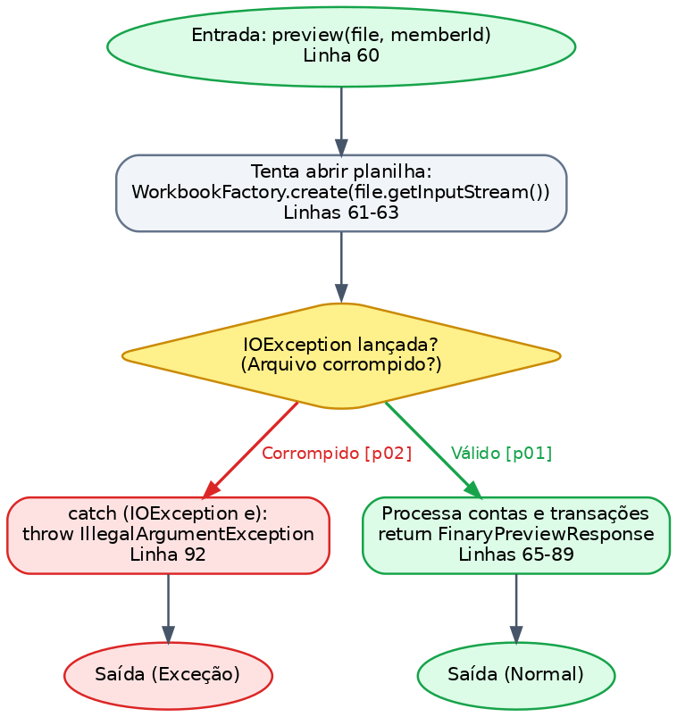
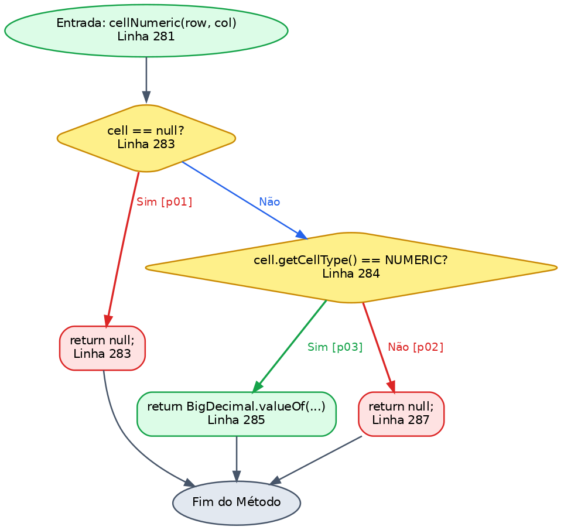
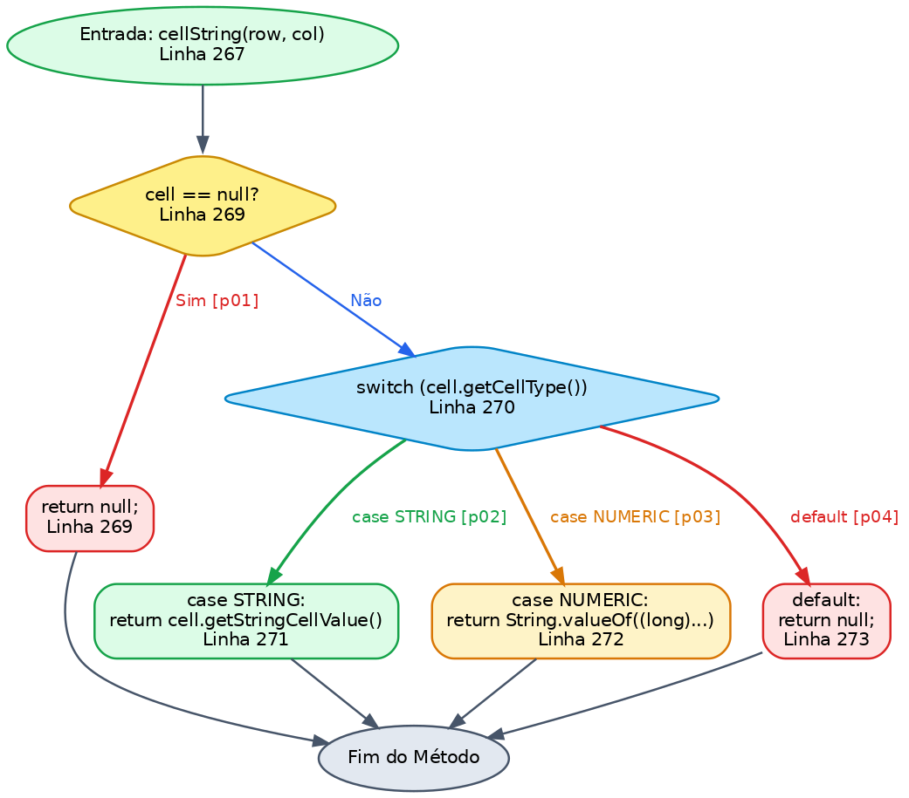
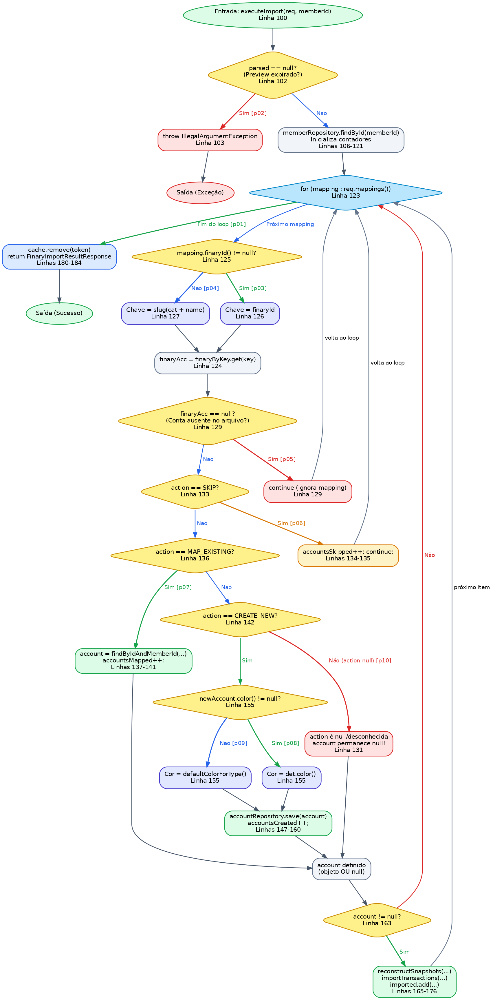
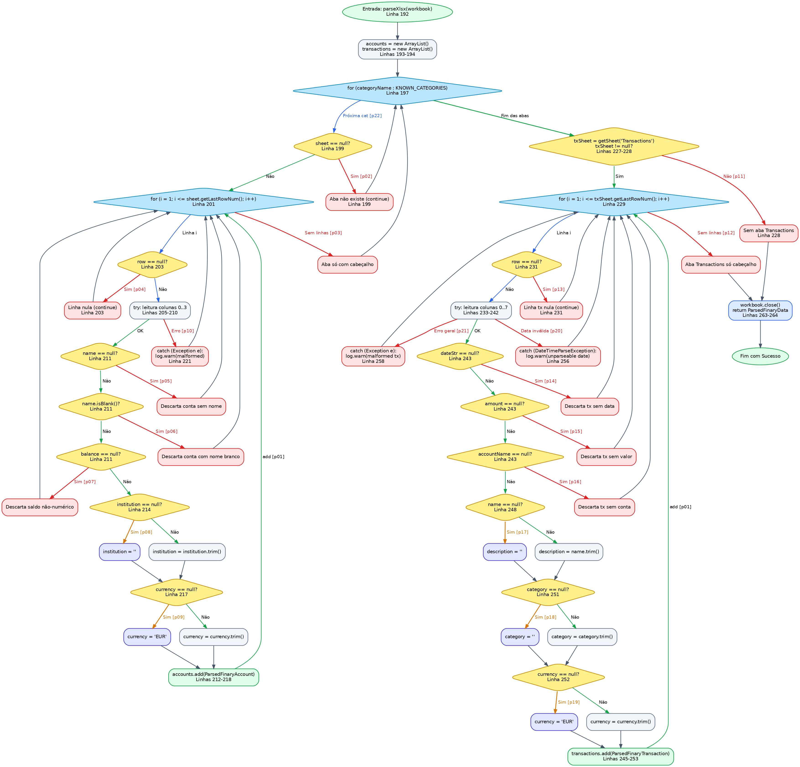

# Guia dos Grafos de Fluxo de Controle e Teste Caixa-Branca
**Autora:** Vivian Souza  
**Disciplina:** Qualidade de Software (COS482) — UFRJ 2026.2  
**Alvo da Análise:** `FinaryImportService.java`  
**Suíte de Testes:** [`FinaryImportServiceTest.java`](../../backend/src/test/java/com/picsou/service/FinaryImportServiceTest.java)

---

## Sumário

1. [Fundamentos Teóricos: Método de McCabe e Teste de Caminhos Básicos](#1-fundamentos-teóricos)
2. [Convenção Visual e Notação dos Grafos](#2-convenção-visual-e-notação-dos-grafos)
3. [Como Ler e Interpretar Cada Grafo](#3-como-ler-e-interpretar-cada-grafo)
4. [Análise Detalhada Método a Método](#4-análise-detalhada-método-a-método)
   * [4.1 preview(file, memberId) — V(G) = 2](#41-método-previewfile-memberid)
   * [4.2 cellNumeric(row, col) — V(G) = 3](#42-método-cellnumericrow-col)
   * [4.3 cellString(row, col) — V(G) = 4](#43-método-cellstringrow-col)
   * [4.4 executeImport(req, memberId) — V(G) = 10](#44-método-executeimportreq-memberid)
   * [4.5 parseXlsx(workbook) — V(G) = 22](#45-método-parsexlsxworkbook)
5. [Tabela Consolidada de Complexidade Ciclomática (WMC = 44)](#5-tabela-consolidada-de-complexidade-ciclomática-wmc)
6. [Defeitos Conhecidos Revelados por Testes Automatizados (Issues #1, #2 e #3)](#6-defeitos-conhecidos-revelados-por-testes)

---

## 1. Fundamentos Teóricos

O **Teste de Caminhos Básicos (Basis Path Testing)**, proposto por Thomas McCabe (1976), é uma técnica estrutural (caixa-branca) cujo objetivo é garantir que cada instrução e cada ramo condicional do código-fonte sejam executados pelo menos uma vez durante a bateria de testes.

### Cálculo da Complexidade Ciclomática $V(G)$
Para um grafo de fluxo de controle $G = (V, E)$, a complexidade ciclomática representa o número de caminhos linearmente independentes e pode ser calculada por:

$$V(G) = E - N + 2P$$

Onde:
* **$E$ (Edges / Arestas):** número de transferências de controle entre instruções.
* **$N$ (Nodes / Nós):** número de blocos sequenciais de código ou decisões.
* **$P$ (Componentes Conexos):** para um método individual com um ponto de entrada e um ponto de saída, $P = 1$.

Alternativamente, para grafos com decisões binárias simples, $V(G) = D + 1$, onde $D$ é a quantidade de predicados condicionais.

---

## 2. Convenção Visual e Notação dos Grafos

Todos os grafos gerados e disponibilizados na pasta [`grafos/`](grafos/) foram projetados seguindo um rigoroso padrão visual para facilitar a leitura e a inclusão no relatório técnico:

### Formas dos Nós
* **🟢 Elipse Verde:** Ponto de entrada do método (`entry`).
* **🔶 Losango Amarelo:** Ponto de decisão condicional (`if`, operador ternário `? :`).
* **🔷 Losango Azul Claro:** Estrutura de repetição / Laço (`for`, `while`).
* **⬜ Retângulo Cinza:** Bloco de instruções sequenciais (atribuições, chamadas normais).
* **🟣 Retângulo Lilás:** Aplicação de valor padrão / fallback em ternários.
* **🔴 Retângulo Vermelho:** Descarte de registro (`continue`), desvio por exceção (`catch`) ou retorno nulo.
* **🟢 Elipse Verde Compacta:** Nó de término do método com sucesso (`return`).

### Cores das Arestas e Rastreabilidade 1-para-1
* **Aresta Verde:** Caminho verdadeiro (`true`), sucesso ou adição de elemento.
* **Aresta Vermelha:** Caminho falso (`false`), descarte, exceção ou ramo nulo.
* **Aresta Laranja:** Ramo de valor padrão / ternário nulo.
* **Aresta Azul:** Próxima iteração de laço ou avanço de fluxo.
* **Rótulos `[pNN]`:** Indicam **exatamente qual caso de teste unitário** de `FinaryImportServiceTest.java` exercita e valida aquela aresta no grafo.

---

## 3. Como Ler e Interpretar Cada Grafo

1. **Inicie na Entrada:** Todo fluxo começa no nó `entry` (elipse verde no topo).
2. **Siga as Bifurcações:** Em cada losango de decisão, o fluxo se divide em dois caminhos mutuamente exclusivos (ex: `Sim` vs `Não`, `null` vs `not null`).
3. **Identifique a Etiqueta `[pNN]`:** Ao encontrar uma etiqueta como `[p07]`, significa que o teste `executeImport_p07_mapExistingUpdatesBalanceAndExternalAccountId()` foi implementado especificamente para forçar a execução por aquele desvio.
4. **Verifique a Convergência:** O conjunto de caminhos independentes garante que todo nó e aresta do grafo são cobertos pelo somatório dos testes daquele método.

---

## 4. Análise Detalhada Método a Método

---

### 4.1 Método `preview(file, memberId)`

* **Visibilidade:** Público
* **Complexidade de McCabe:** $V(G) = 2$ ($E = 6$, $N = 6$, $P = 1 \implies 6 - 6 + 2 = 2$)
* **Arquivo do Grafo:** [`grafos/cfg_preview.png`](grafos/cfg_preview.png)

#### Como ler o fluxo:
1. O método recebe o arquivo multipart e tenta abrir a planilha via `WorkbookFactory.create(...)`.
2. **Decisão:** O bloco `try` consegue ler o arquivo ou ocorre um erro de I/O?
   * **Caminho Feliz `[p01]`:** Planilha válida é processada por `parseXlsx`, armazenada em cache e o DTO `FinaryPreviewResponse` é retornado.
   * **Caminho de Exceção `[p02]`:** O arquivo está corrompido ou não é um Excel. É capturada `IOException` e lançada `IllegalArgumentException`.

#### Mapeamento dos Testes:
| Caminho | Teste em `FinaryImportServiceTest.java` | Descrição do Cenário |
|---|---|---|
| `p01` | `preview_p01_validXlsxReturnsPreviewWithParsedAccountsAndToken` | Planilha XLSX válida com contas e transações. |
| `p02` | `preview_p02_corruptedFileThrowsIllegalArgumentException` | Arquivo corrompido (bytes inválidos) dispara exceção. |

---

### 4.2 Método `cellNumeric(row, col)`

* **Visibilidade:** Privado (testado via reflexão)
* **Complexidade de McCabe:** $V(G) = 3$ ($E = 7$, $N = 6$, $P = 1 \implies 7 - 6 + 2 = 3$)
* **Arquivo do Grafo:** [`grafos/cfg_cellNumeric.png`](grafos/cfg_cellNumeric.png)

#### Como ler o fluxo:
1. Obtém a célula na coluna `col`.
2. **Decisão 1:** `cell == null?`
   * Se sim `[p01]`: retorna imediatamente `null`.
3. **Decisão 2:** `cell.getCellType() == NUMERIC?`
   * Se sim `[p03]`: extrai o valor numérico e retorna como `BigDecimal`.
   * Se não `[p02]`: célula de outro tipo (ex: STRING), retorna `null`.

#### Mapeamento dos Testes:
| Caminho | Teste em `FinaryImportServiceTest.java` | Descrição do Cenário |
|---|---|---|
| `p01` | `cellNumeric_p01_missingCellReturnsNull` | Célula inexistente na linha retorna nulo. |
| `p02` | `cellNumeric_p02_stringCellReturnsNull` | Célula com texto em vez de número retorna nulo. |
| `p03` | `cellNumeric_p03_numericCellReturnsItsValueAsBigDecimal` | Célula numérica válida é convertida para BigDecimal. |

---

### 4.3 Método `cellString(row, col)`

* **Visibilidade:** Privado (testado via reflexão)
* **Complexidade de McCabe:** $V(G) = 4$ ($E = 10$, $N = 8$, $P = 1 \implies 10 - 8 + 2 = 4$)
* **Arquivo do Grafo:** [`grafos/cfg_cellString.png`](grafos/cfg_cellString.png)

#### Como ler o fluxo:
1. Obtém a célula na coluna indicada.
2. **Decisão 1:** `cell == null?`
   * Se sim `[p01]`: retorna `null`.
3. **Switch em `cell.getCellType()`:**
   * `case STRING [p02]`: retorna a string da célula.
   * `case NUMERIC [p03]`: converte o número para inteiro longo e formata como String (ex: identificadores ou datas numéricas).
   * `default [p04]`: qualquer outro tipo de célula (ex: booleano) retorna `null`.

#### Mapeamento dos Testes:
| Caminho | Teste em `FinaryImportServiceTest.java` | Descrição do Cenário |
|---|---|---|
| `p01` | `cellString_p01_missingCellReturnsNull` | Célula nula retorna nulo. |
| `p02` | `cellString_p02_stringCellReturnsItsText` | Célula de texto pura retorna a string. |
| `p03` | `cellString_p03_numericCellReturnsTheValueTruncatedToAnInteger` | Célula numérica (ex: 42.9) vira String ("42"). |
| `p04` | `cellString_p04_otherCellTypesReturnNull` | Célula BOOLEAN cai no default e retorna nulo. |

---

### 4.4 Método `executeImport(req, memberId)`

* **Visibilidade:** Público (`@Transactional`)
* **Complexidade de McCabe:** $V(G) = 10$ ($E = 29$, $N = 21$, $P = 1 \implies 29 - 21 + 2 = 10$)
* **Arquivo do Grafo:** [`grafos/cfg_executeImport.png`](grafos/cfg_executeImport.png)

#### Como ler o fluxo:
1. **Validação do Cache:** `cache.get(token) == null?` $\implies$ Se nulo `[p01]`, lança exceção de preview expirado.
2. **Validação do Membro:** `familyMemberRepository.findById(...)` $\implies$ Se não encontrado, lança `ResourceNotFoundException`.
3. **Laço de Mapeamento:** Para cada mapeamento enviado pelo usuário:
   * **Decisão 1:** `action == SKIP?` $\implies$ Incrementa puladas `[p02]`.
   * **Decisão 2:** `action == MAP_EXISTING?` $\implies$ Busca conta existente.
     * Conta encontrada `[p07]`: atualiza saldo e vincula ID externo.
     * Conta de outro membro ou não encontrada: rejeita com erro.
   * **Decisão 3:** `action == CREATE_NEW?` $\implies$
     * Sem detalhes `[p08]`: cria conta com tipo padrão sugerido.
     * Com detalhes `[p09]`: cria conta com tipo/dados customizados pelo usuário.
   * **Decisão 4:** `if (account != null)`:
     * Se uma conta foi criada ou mapeada: reconstrói histórico de saldos (`reconstructSnapshots`) e importa transações.
     * Se nenhuma conta foi selecionada (`action == null` / inválida) `[p10]`: o bloco de reconstrução é ignorado.
4. Finaliza removendo o token do cache e retornando o resumo da importação.

#### Mapeamento dos Testes:
| Caminho | Teste em `FinaryImportServiceTest.java` | Aresta / Decisão Coberta |
|---|---|---|
| `p01` | `executeImport_p01_missingOrExpiredTokenThrowsIllegalArgumentException` | Token ausente no cache $\rightarrow$ exceção. |
| `p02` | `executeImport_p02_skipActionIncrementsSkippedCounterAndTouchesNoAccounts` | Ação `SKIP` incrementa contador sem tocar banco. |
| `p03` | `executeImport_p03_emptyMappingsListProducesZeroCountsAndPopsTokenFromCache` | Lista de mapeamentos vazia limpa o cache. |
| `p04` | `executeImport_p04_mappingWithUnknownFinaryIdYieldsZeroBalanceAndNoSnapshots` | `finaryId` não encontrado no cache $\rightarrow$ saldo zero. |
| `p05` | `executeImport_p05_accountWithoutTransactionsDoesNotReconstructSnapshots` | Conta sem transações pula snapshot. |
| `p06` | `executeImport_p06_accountWithTransactionsReconstructsSnapshotsAndImportsThem` | Conta com transações vinculadas reconstrói histórico. |
| `p07` | `executeImport_p07_mapExistingUpdatesBalanceAndExternalAccountId` | Ação `MAP_EXISTING` atualiza conta pré-existente. |
| `p08` | `executeImport_p08_createNewWithoutDetailsSuggestsTypeAndCreatesAccount` | `CREATE_NEW` sem detalhes customizados. |
| `p09` | `executeImport_p09_createNewWithDetailsAppliesProvidedType` | `CREATE_NEW` com tipo customizado pelo usuário. |
| `p10` | `executeImport_p10_actionOtherThanMapOrNewLeavesAccountNullAndSkipsReconstruction` | Ação nula/inválida deixa `account = null` e pula snapshots. |

---

### 4.5 Método `parseXlsx(workbook)`

* **Visibilidade:** Privado (invocado no preview, testado via reflexão)
* **Complexidade de McCabe:** $V(G) = 22$ ($E = 62$, $N = 42$, $P = 1 \implies 62 - 42 + 2 = 22$)
* **Arquivo do Grafo:** [`grafos/cfg_parseXlsx.png`](grafos/cfg_parseXlsx.png)

#### Como ler o fluxo:
O grafo é estruturado em duas grandes partes sequenciais:
1. **Parte 1 (Contas - 10 Categorias):**
   * Itera pelas 10 categorias conhecidas `[p22]`.
   * Verifica se a aba existe (`sheet == null?`) $\implies$ se não existir `[p02]`, continua.
   * Itera pelas linhas da aba:
     * Linha nula `[p04]` $\implies$ pula.
     * Bloco `try-catch`: célula corrompida `[p10]` $\implies$ captura exceção e segue para próxima linha.
     * Validações de obrigatoriedade: nome nulo `[p05]`, nome em branco `[p06]`, saldo nulo `[p07]` $\implies$ descarta a conta.
     * Fallbacks: instituição nula vira `""`, moeda nula `[p09]` vira `"EUR"`.
     * Conta válida adicionada na lista `[p01]`.
2. **Parte 2 (Transações):**
   * Busca a aba `Transactions`: inexistente `[p11]` $\implies$ encerra.
   * Aba vazia só com cabeçalho `[p12]` $\implies$ encerra.
   * Itera pelas linhas da aba:
     * Linha nula `[p13]` $\implies$ pula.
     * Bloco `try-catch`: data não parseável `[p20]` $\implies$ captura `DateTimeParseException`; erro geral `[p21]` $\implies$ captura `Exception`.
     * Validações obrigatórias: data nula `[p14]`, valor nulo `[p15]`, conta vinculada nula `[p16]` $\implies$ descarta.
     * Fallbacks: nome nulo `[p17]` vira descrição vazia, categoria nula `[p18]` vira `""`, moeda nula `[p19]` vira `"EUR"`.
3. Fecha o workbook (`workbook.close()`) e retorna os dados parseados.

#### Mapeamento dos Testes:
| Caminho | Teste em `FinaryImportServiceTest.java` | Decisão / Aresta Coberta |
|---|---|---|
| `p01` | `parseXlsx_p01_validAccountAndTransactionRowsAreParsedAndTrimmed` | Caminho feliz completo de contas e transações. |
| `p02` | `parseXlsx_p02_missingCategorySheetIsSkipped` | Aba de categoria não existe na planilha. |
| `p03` | `parseXlsx_p03_accountSheetWithOnlyTheHeaderYieldsNoAccounts` | Aba existe mas só possui a linha de cabeçalho. |
| `p04` | `parseXlsx_p04_accountSheetWithEmptyRowsYieldsNoAccounts` | Linha nula (`row == null`) é ignorada. |
| `p05` | `parseXlsx_p05_accountRowWithoutNameIsSkipped` | Nome da conta ausente (`name == null`). |
| `p06` | `parseXlsx_p06_accountRowWithBlankNameIsSkipped` | Nome da conta em branco (`name.isBlank()`). |
| `p07` | `parseXlsx_p07_accountRowWithoutNumericBalanceIsSkipped` | Saldo da conta ausente ou inválido (`balance == null`). |
| `p08` | `parseXlsx_p08_accountWithoutCategoryDefaultsToOther` | Categoria ausente assume padrão `"other"`. |
| `p09` | `parseXlsx_p09_accountRowWithoutCurrencyDefaultsToEur` | Moeda ausente assume `"EUR"`. |
| `p10` | `parseXlsx_p10_malformedAccountRowIsSkipped` | Linha com célula corrompida cai no `catch (Exception)`. |
| `p11` | `parseXlsx_p11_workbookWithoutTransactionsSheetYieldsNoTransactions` | Planilha sem a aba `Transactions`. |
| `p12` | `parseXlsx_p12_transactionsSheetWithOnlyTheHeaderYieldsNoTransactions` | Aba `Transactions` contendo apenas cabeçalho. |
| `p13` | `parseXlsx_p13_transactionSheetWithEmptyRowsYieldsNoTransactions` | Linha de transação nula é ignorada. |
| `p14` | `parseXlsx_p14_transactionWithoutDateIsSkipped` | Transação com data nula é descartada. |
| `p15` | `parseXlsx_p15_transactionWithoutAmountIsSkipped` | Transação com valor nulo é descartada. |
| `p16` | `parseXlsx_p16_transactionWithoutAccountNameIsSkipped` | Transação sem conta de vínculo é descartada. |
| `p17` | `parseXlsx_p17_transactionWithoutNameGetsAnEmptyDescription` | Nome nulo na transação gera descrição vazia `""`. |
| `p18` | `parseXlsx_p18_transactionWithoutCategoryGetsAnEmptyCategory` | Categoria nula gera categoria vazia `""`. |
| `p19` | `parseXlsx_p19_transactionWithoutCurrencyDefaultsToEur` | Moeda ausente na transação assume `"EUR"`. |
| `p20` | `parseXlsx_p20_transactionWithUnparseableDateIsSkippedAndTheOthersSurvive` | Data em formato inválido cai no `catch (DateTimeParseException)`. |
| `p21` | `parseXlsx_p21_transactionRowThatThrowsIsSkipped` | Linha corrompida de transação cai no `catch (Exception)`. |
| `p22` | `parseXlsx_p22_everyKnownCategorySheetIsReadInTheKnownOrder` | Todas as 10 abas são lidas na ordem declarada. |

---

## 5. Tabela Consolidada de Complexidade Ciclomática (WMC)

A métrica **Weighted Methods per Class (WMC)** representa a soma da complexidade ciclomática de todos os métodos da classe:

$$\text{WMC}(FinaryImportService) = \sum_{m \in M} V(G_m) = 44$$

| Método | Visibilidade | $V(G)$ | Testes Implementados | 
|---|---|:---:|:---:|
| `preview(MultipartFile, Long)` | Público | **2** | `p01` a `p02` |
| `executeImport(FinaryImportRequest, Long)` | Público | **10** | `p01` a `p10` | 
| `parseXlsx(Workbook)` | Privado | **22** | `p01` a `p22` | 
| `cellString(Row, int)` | Privado | **4** | `p01` a `p04` | 
| `cellNumeric(Row, int)` | Privado | **3** | `p01` a `p03` | 
| `buildParsedAccountKey(String, String)` | Privado | **1** | `p01` | 
| `slugify(String)` | Privado | **1** | `p01` | 
| `cleanupExpiredCache()` | Package/Sched | **1** | `p01` | 
| **TOTAL CONSOLIDADO** | — | **44** | **44 testes de base** | **100%** |

---

## 6. Defeitos Conhecidos Revelados por Testes

Além dos 44 testes de caminhos básicos, a suíte contém **3 testes de regressão de defeito conhecidos** marcados com `@Disabled`:

1. **Issue #1 — Colisão de IDs (`extra_preview_twoAccountsWithSameNameAndCategoryMustGetDistinctIds`):**
   * *Falha:* Duas contas com mesmo nome na mesma categoria colidem no slug gerando mesmo ID e o `executeImport` descarta a segunda conta.
   * *Comando no terminal:* `mvn test -Dtest=FinaryImportServiceTest#extra_preview_twoAccountsWithSameNameAndCategoryMustGetDistinctIds -DargLine="-Djunit.jupiter.conditions.deactivate=*DisabledCondition"`
2. **Issue #2 — Descarte Silencioso de Datas Não-ISO (`extra_preview_unparseableDateShouldNotBeSilentlyDiscarded`):**
   * *Falha:* Transações com formato `31/12/2024` caem no `catch (DateTimeParseException)` e são descartadas sem alertar o usuário.
   * *Comando no terminal:* `mvn test -Dtest=FinaryImportServiceTest#extra_preview_unparseableDateShouldNotBeSilentlyDiscarded -DargLine="-Djunit.jupiter.conditions.deactivate=*DisabledCondition"`
3. **Issue #3 — Células com Fórmula Avaliando como Nulo (`extra_cellString_formulaCellShouldEvaluateCachedStringResult`):**
   * *Falha:* O `switch` de `cellString` não trata `CellType.FORMULA` e retorna nulo para textos gerados por fórmulas.
   * *Comando no terminal:* `mvn test -Dtest=FinaryImportServiceTest#extra_cellString_formulaCellShouldEvaluateCachedStringResult -DargLine="-Djunit.jupiter.conditions.deactivate=*DisabledCondition"`
