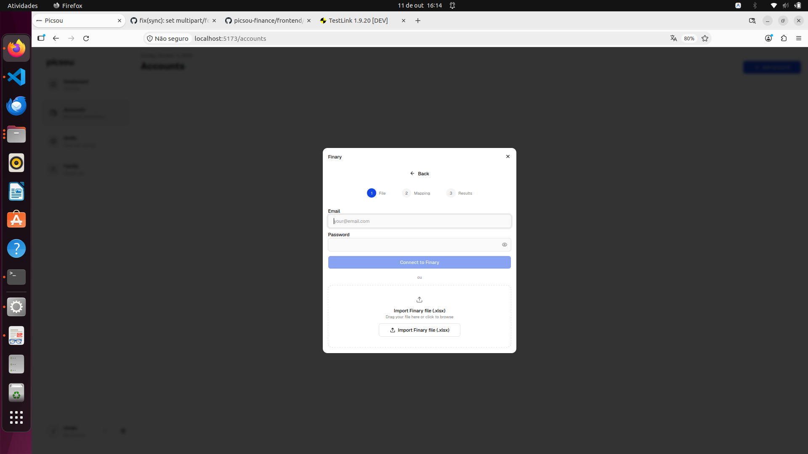
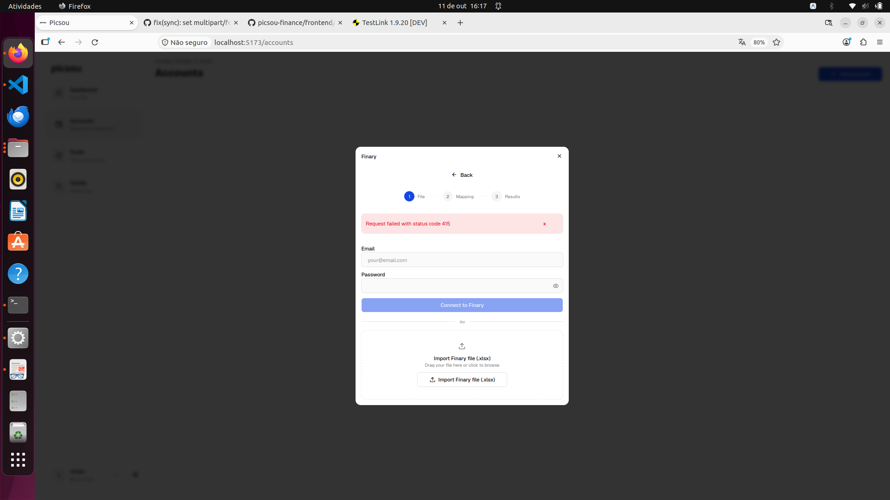
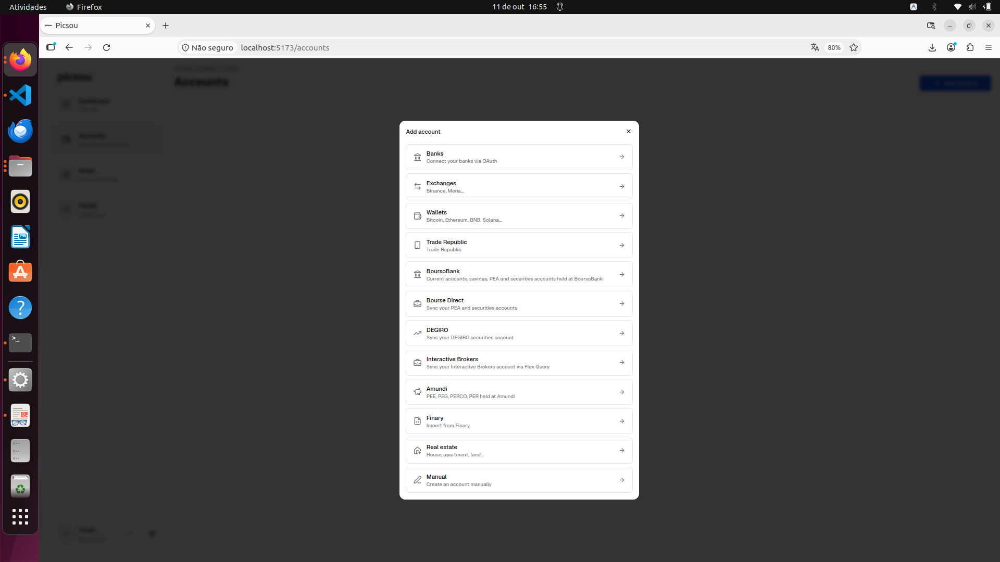
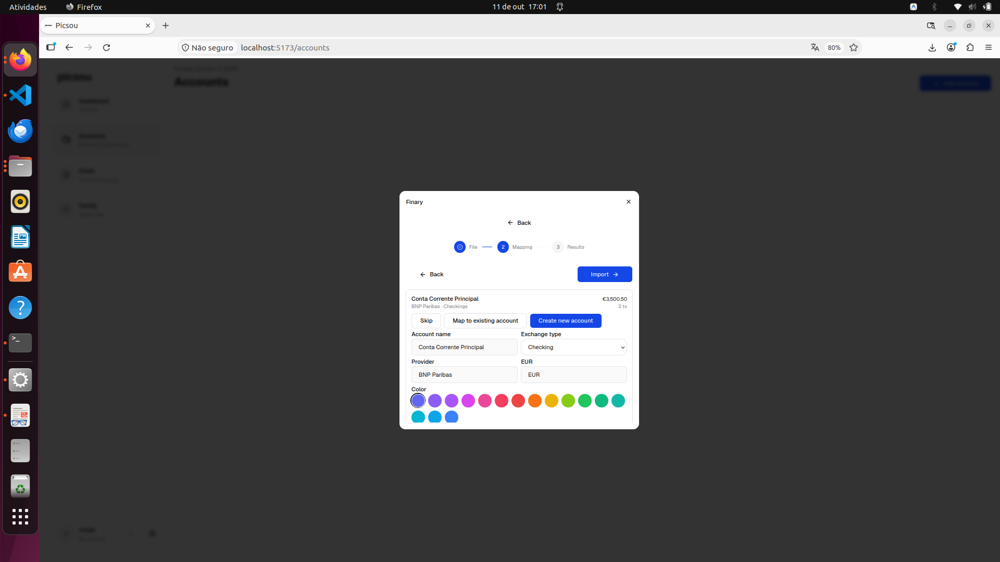
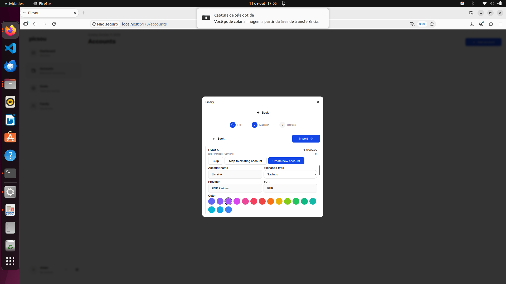
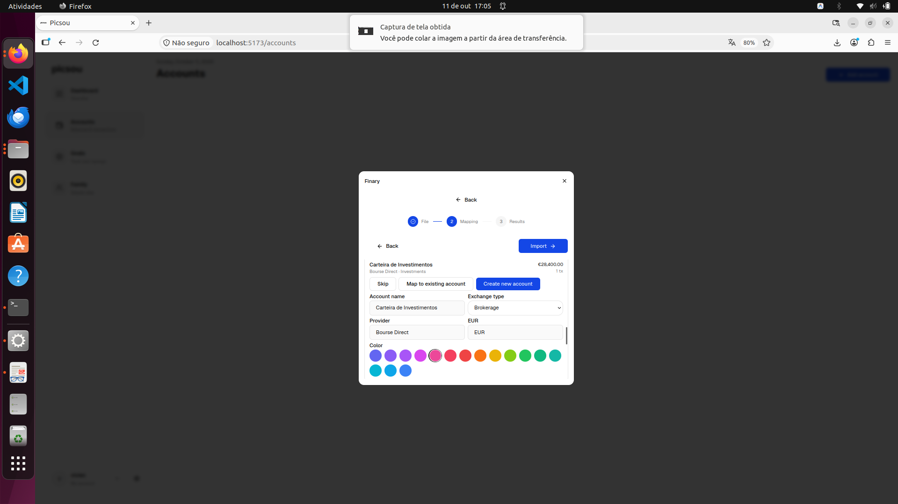
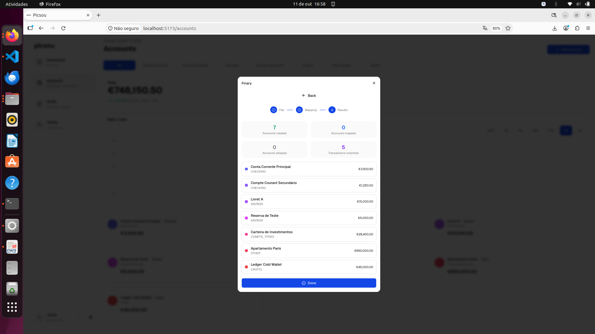
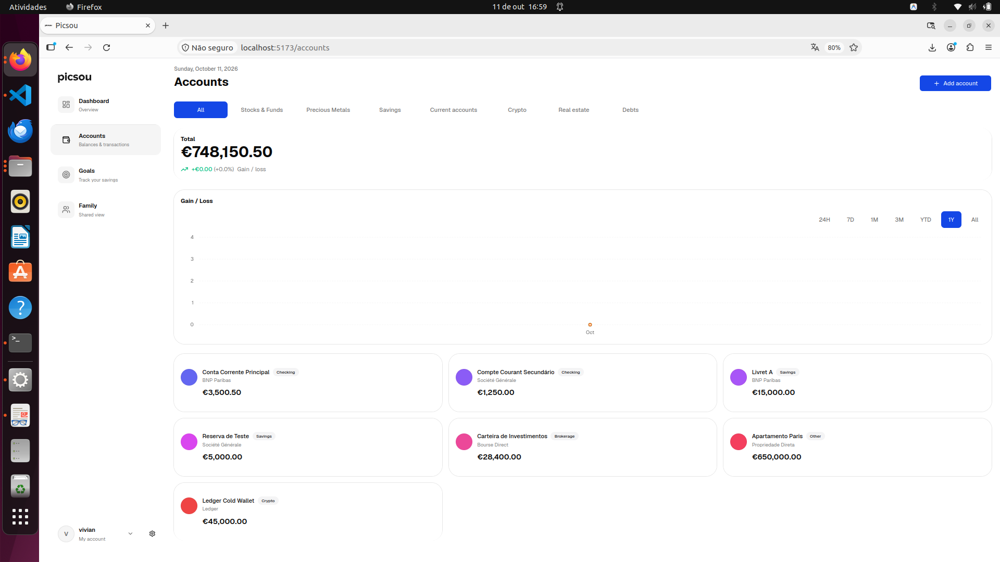
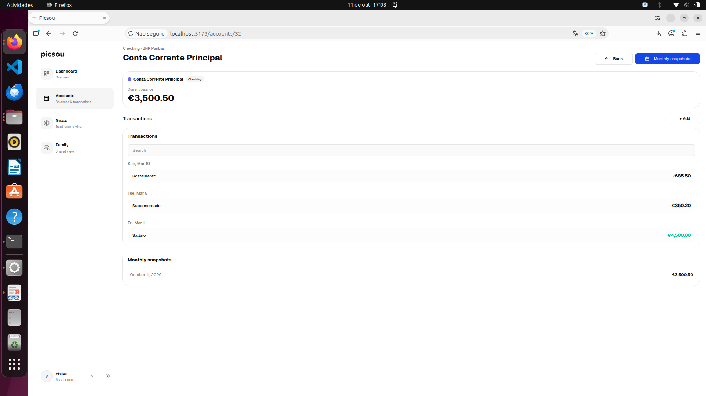

# Relatório de Execução de Testes Manuais (Caixa-Preta / TestLink)

**Testadora:** Vivian Souza  
**Disciplina:** Qualidade de Software (COS482) — UFRJ 2026.2  
**Ferramenta de Gestão:** TestLink  
**Caso de Teste Único:** `dd-3` — Pré-visualização e importação com criação de novas contas (`CREATE_NEW`)  
**Arquivo de Entrada:** [`finary_testlink_dummy.xlsx`](finary_testlink_dummy.xlsx) (7 contas e 5 transações em EUR)

## 1. Visão Geral e Histórico da Execução

Nesta etapa prática de testes funcionais (caixa-preta), foi planejado e executado no TestLink um **caso de teste de ponta a ponta (End-to-End)** cobrindo todas as etapas de importação de dados externos do Finary para o dashboard financeiro do Picsou.

Durante a realização prática, vivenciamos o **ciclo clássico de Garantia da Qualidade de Software**:
1. **Primeira Execução:** Iniciamos a execução dos 9 passos do caso de teste. No Passo 3, ao submeter o arquivo `.xlsx`, a aplicação retornou um erro inesperado de servidor (`HTTP 415`), interrompendo o fluxo e bloqueando os passos seguintes.
2. **Registro de Defeito:** O teste foi marcado como **Failed** no TestLink e uma issue formal foi aberta no GitHub: **[Issue #2 — Erro 415 no Upload de Planilha Finary](https://github.com/mssvivian/picsou-finance-QS_2026.2/issues/2)**.
3. **Mitigação do Código:** O time corrigiu o tratamento de *Content-Type* multipart no commit `9231231dca0377d56dee877f89765371202b83d5`.
4. **Segunda Execução (Re-teste):** O mesmo caso de teste foi re-executado em nova build, atingindo **100% de sucesso** em todos os 9 passos, com os saldos e transações devidamente persistidos no banco de dados e refletidos no frontend.

## 2. Primeira Execução: Falha Bloqueante e Abertura da Issue #2

* **Data da Execução:** 10/11/2026 18:53  
* **Resultado:** **Failed (Bloqueante no Passo 3)**  
* **Relatório Oficial TestLink:** [`finary-test-falha/ExecuçãoFalhaFinary.html`](finary-test-falha/ExecuçãoFalhaFinary.html)

### Descrição do Comportamento Observado:
Os Passos 1 e 2 foram concluídos normalmente (acesso à tela de contas e abertura do modal do Finary). Contudo, ao chegar no **Passo 3** (submissão da planilha), o upload foi rejeitado pela API com o erro `Request failed with status code 415 (Unsupported Media Type)`. Com o erro de rede, o modal não avançou para a tela de mapeamento (*2 Mapping*), tornando impossível avaliar os passos 4 a 9 (que foram registrados como *Blocked*).

### Evidências da Falha:

#### Navegação e Abertura do Conector Finary
O usuário navega até a tela de contas e aciona o botão `+ Add account`, selecionando a opção `Finary`.

#### Erro de Upload no Passo 3 (HTTP 415)
Ao submeter o arquivo `finary_testlink_dummy.xlsx`, o sistema falhou ao consumir o arquivo, exibindo a notificação de erro no canto superior direito e travando o assistente.

* **Ação Corretiva:** Abertura da [Issue #2 no GitHub](https://github.com/mssvivian/picsou-finance-QS_2026.2/issues/2) com o log do navegador e o arquivo para reprodução.

## 3. Mitigação do Defeito

* **Commit Mitigador:** `9231231dca0377d56dee877f89765371202b83d5`
* **Correção:** Ajuste no cabeçalho e na configuração do controlador REST backend para aceitar o tipo MIME `application/vnd.openxmlformats-officedocument.spreadsheetml.sheet`, permitindo que o upload de planilhas Excel seja aceito sem rejeição 415.

## 4. Segunda Execução: Re-teste Passo a Passo com Sucesso Pleno

* **Data da Execução:** 10/11/2026 19:15  
* **Resultado:** **Passed (9 de 9 passos aprovados)**  
* **Duração:** 12 minutos  
* **Relatório Oficial TestLink:** [`finary-teste-sucesso/ExecuçãoSucessoFinary.html`](finary-teste-sucesso/ExecuçãoSucessoFinary.html)

Abaixo, é apresentado o detalhamento de cada um dos **9 passos executados**, os comportamentos esperados e as evidências visuais capturadas em tempo real:

### Passo 1: Acesso ao Modal de Adição de Contas
* **Ação:** Clicar em **Accounts** no menu lateral esquerdo. No canto superior direito da página, clicar no botão **"+ Add account"**.
* **Resultado Esperado:** Abre-se o modal central listando todas as opções de conectores de conta disponíveis (Manual, Bank sync, Finary, Trade Republic, etc.).
* **Resultado Obtido:** Aprovado (modal aberto sobre a listagem limpa).

---

### Passo 2: Seleção do Conector Finary
* **Ação:** No modal, clicar sobre a opção **"Finary"**.
* **Resultado Esperado:** O modal avança para a etapa *1 File* do assistente de importação do Finary, apresentando o botão de upload e orientações.
* **Resultado Obtido:** Aprovado (etapa 1 File exibida com botão de upload visível).

---

### Passo 3: Envio da Planilha e Pré-visualização Automática
* **Ação:** Clicar em **"Import Finary file (.xlsx)"** e submeter o arquivo [`finary_testlink_dummy.xlsx`](finary_testlink_dummy.xlsx).
* **Resultado Esperado:** O arquivo é aceito e processado pelo servidor. O assistente avança automaticamente para a etapa **2 Mapping**, apresentando o resumo de contas e transações lidas.
* **Resultado Obtido:** Aprovado pós-mitigação (sem erro 415, avanço imediato para o Mapping com totalizador de 5 transações).

---

### Passo 4: Validação do Cartão da Conta Principal
* **Ação:** Inspecionar o primeiro cartão de conta exibido na tela de mapeamento ("Conta Corrente Principal").
* **Resultado Esperado:** O cabeçalho deve exibir exatamente:
  * Nome: **"Conta Corrente Principal"**
  * Subtítulo: **"BNP Paribas · Checkings"**
  * Saldo: **€3,500.50**
  * Contador de transações: **3 tx** vinculadas
  * Botão de ação: **"Create new account"** pré-selecionado por padrão.
* **Resultado Obtido:** Aprovado (todos os valores conferem rigorosamente com a planilha).

---

### Passo 5: Verificação dos Campos de Configuração Derivados
* **Ação:** Conferir os campos internos de criação no cartão da conta principal: *Account name*, *Account type*, *Provider*, *Moeda* e a paleta de cores.
* **Resultado Esperado:** Campos preenchidos automaticamente:
  * *Account name:* "Conta Corrente Principal"
  * *Type:* "Checking"
  * *Provider:* "BNP Paribas"
  * *Currency:* "EUR"
* **Resultado Obtido:** Aprovado (mapeamento de tipo automático correto).

---

### Passo 6: Conferência dos Demais 6 Cartões de Contas
* **Ação:** Rolar a listagem de mapeamento e validar individualmente os demais 6 cartões derivados das diferentes abas do Excel.
* **Resultado Esperado:** Todos os 7 cartões presentes com dados consistentes e ação `CREATE_NEW` pré-selecionada.
* **Resultado Obtido:** Aprovado. Todas as 6 contas adicionais foram reconhecidas corretamente:

| Conta | Categoria | Instituição | Saldo (EUR) | Ação de Mapeamento |
|---|---|---|:---:|:---:|
| **Compte Courant Secundário** | Checkings | Société Générale | €1,250.00 | CREATE_NEW |
| **Livret A** | Savings | BNP Paribas | €15,000.00 | CREATE_NEW |
| **Reserva de Teste** | Savings | Société Générale | €5,000.00 | CREATE_NEW |
| **Carteira de Investimentos** | Investments | Bourse Direct | €28,400.00 | CREATE_NEW |
| **Apartamento Paris** | Real Estate | — | €650,000.00 | CREATE_NEW |
| **Ledger Cold Wallet** | Cryptos | — | €45,000.00 | CREATE_NEW |

Clique para visualizar as capturas individuais de cada cartão (Passo 6)

 

| Cartão 1: Conta Principal (€3,500.50) | Cartão 2: Compte Secundário (€1,250.00) |
|:---:|:---:|
|  |  |

| Cartão 3: Livret A (€15,000.00) | Cartão 4: Reserva de Teste (€5,000.00) |
|:---:|:---:|
|  |  |

| Cartão 5: Investimentos (€28,400.00) | Cartão 6: Apartamento Paris (€650,000.00) |
|:---:|:---:|
|  |  |

---

### Passo 7: Confirmação e Execução da Importação
* **Ação:** No canto superior direito do modal, clicar no botão **"Import ->"**.
* **Resultado Esperado:** O botão entra em estado de carregamento (*loading*), a chamada de `executeImport` é concluída com HTTP 200 e o assistente avança para a etapa **3 Results**, exibindo o resumo de contas criadas e transações importadas.
* **Resultado Obtido:** Aprovado (resumo de conclusão exibido com sucesso).

---

### Passo 8: Validação da Persistência na Página de Contas
* **Ação:** Fechar o modal de importação e visualizar a página principal de **Accounts**.
* **Resultado Esperado:** Todas as 7 novas contas devem aparecer agrupadas em suas categorias (*Cash*, *Savings*, *Investments*, *Real Estate*, *Cryptos*), com seus respectivos saldos somando ao patrimônio líquido total.
* **Resultado Obtido:** Aprovado (todas as contas ativas com saldo correto).

---

### Passo 9: Inspeção do Extrato e Transações Vinculadas
* **Ação:** Clicar sobre o cartão da **"Conta Corrente Principal"** para abrir o extrato detalhado da conta.
* **Resultado Esperado:** O extrato lista as 3 transações importadas da aba `Transactions`, com datas, descrições e valores corretos:
  1. *Salário* (+€4,500.00)
  2. *Supermercado* (-€350.20)
  3. *Restaurante* (-€85.50)
* **Resultado Obtido:** Aprovado (todas as 3 transações vinculadas e exibidas no extrato com cálculos corretos de saldo).

---

## 5. Conclusão da Análise Funcional

A execução deste teste manual no TestLink comprovou:
1. **Eficácia da Gestão de Defeitos:** O ciclo de vida do erro 415 demonstrou a importância do teste manual funcional, revelando uma falha de configuração de API que impedia o uso real da funcionalidade pelo usuário.
2. **Integridade de Dados:** Após a mitigação, todas as 7 contas e suas 5 transações foram consumidas, tipadas, persistidas e calculadas sem qualquer perda de precisão monetária.
3. **Consistência de Interface:** O fluxo visual em 3 etapas (*File* $\rightarrow$ *Mapping* $\rightarrow$ *Results*) proporcionou transparência ao usuário, permitindo revisar cada saldo antes de gravar no banco de dados.
