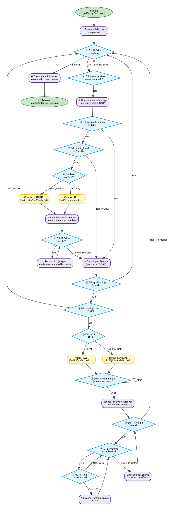
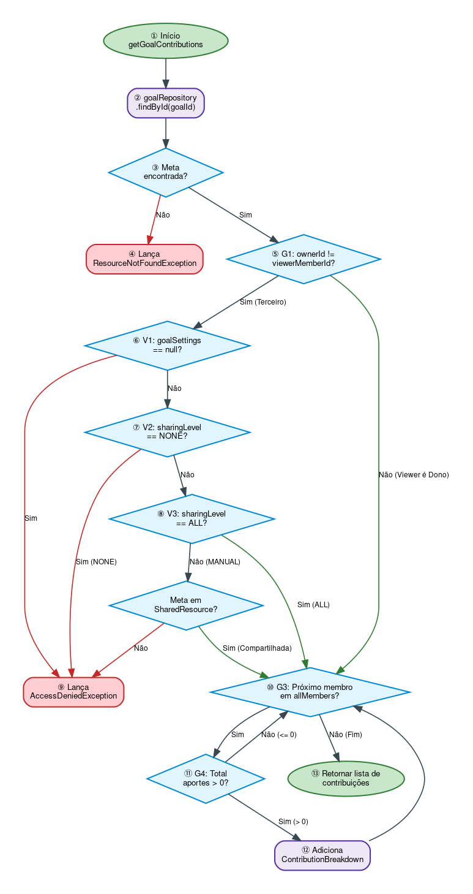

# Relatório de Testes Unitários Automáticos — `FamilyViewServiceTest`

**Disciplina:** Qualidade de Software (COS482 - UFRJ / COPPE)    
**Autora:** Carolina Falcão  
**Classe sob teste:** [`FamilyViewService.java`](../../backend/src/main/java/com/picsou/service/FamilyViewService.java)  
**Classe de teste:** [`FamilyViewServiceTest.java`](../../backend/src/test/java/com/picsou/service/FamilyViewServiceTest.java)  
**Tecnologias:** Java 21, JUnit 5 (Jupiter), Mockito 5, Maven  
**Link Geral:** [← Voltar ao Índice do Dossiê](../README.md)

---

## 1. Justificativa Teórica e Escolha da Classe

No escopo do trabalho, é exigido que cada integrante do grupo selecione **pelo menos uma classe de alta complexidade com Complexidade Ciclomática $V(G) \ge 10$**, evitando CRUDs simples ou entidades anêmicas.

### Motivação da Escolha de `FamilyViewService`
A classe [`FamilyViewService.java`](../../backend/src/main/java/com/picsou/service/FamilyViewService.java) foi selecionada com base nos seguintes critérios técnicos e metodológicos:

* **Alta Complexidade Ciclomática ($V(G) \ge 10$):** O método principal `getFamilyDashboard` possui $V(G) = 14$ ($P = 13$ pontos de decisão de desvio), atendendo plenamente à exigência da disciplina. Além disso, a complexidade ciclomática acumulada da classe ($WMC$) totaliza **24**;
* **Domínio de Regra de Negócio Crítica:** Trata-se da lógica central de privacidade financeira familiar do sistema Picsou Finance, responsável por consolidar e projetar o patrimônio compartilhado e as metas conjuntas respeitando níveis de autorização estritos (`ALL`, `MANUAL`, `NONE`);
* **Múltiplos Fluxos e Laços Iterativos Dependentes:** Contém algoritmos com laços aninhados (iteração sobre membros da família, contas bancárias, metas e lista de contribuidores com ponderação monetária), fornecendo um cenário rico para o mapeamento de caminhos básicos e testes de valores limite;
* **Uso Essencial de Dublês de Teste (Mockito):** A classe orquestra **8 dependências externas** (6 repositórios JPA e 2 serviços de apoio), viabilizando o isolamento estrito via dublês (`@Mock`, `@InjectMocks`) e asserções de interação (`verify`);
* **Validação de Exceções de Domínio:** O fluxo prevê o lançamento de exceções reais de negócio e segurança (`ResourceNotFoundException` e `AccessDeniedException`), permitindo testar cenários negativos com `assertThrows`.

### Alinhamento com o Modelo RIP (Reachability, Infection, Propagation)
A suíte foi concebida para garantir as três condições fundamentais para a revelação de falhas:
1. **Alcance (*Reachability*):** Os dados de entrada de cada teste forçam o fluxo de execução a alcançar especificamente cada uma das 13 decisões de controle;
2. **Infecção (*Infection*):** Entradas limítrofes e combinações de nível de compartilhamento (`ALL`, `MANUAL`, `NONE`) alteram o estado das variáveis intermediárias (ex.: cota nula forçando peso zero);
3. **Propagação (*Propagation*):** O estado incorreto reverbera diretamente até os objetos retornados (`FamilyDashboardResponse` e `ContributionBreakdownResponse`), onde as asserções capturam qualquer divergência.

---

## 2. Análise da Complexidade Ciclomática $V(G)$

A Complexidade Ciclomática de McCabe define o número de caminhos linearmente independentes através do grafo de fluxo de controle de um programa:
$$V(G) = P + 1$$
*(onde $P$ representa a quantidade de pontos de decisão binária no código-fonte).*

### 2.1 Método `getFamilyDashboard(Long viewerMemberId)` $\rightarrow$ **$V(G) = 14$**

| # Ponto | Linha | Expressão no Código-Fonte | Tipo de Estrutura |
| :-: | :-: | :--- | :--- |
| **D1** | 59 | `for (FamilyMember member : allMembers)` | Loop de iteração |
| **D2** | 61 | `if (member.getId().equals(viewerMemberId)) continue;` | Desvio condicional |
| **D3** | 70 | `if (accountSettings != null ...` | Predicado lógico |
| **D4** | 70 | `... && level != NONE)` | Operador lógico `&&` |
| **D5** | 72 | `if (level == ALL)` *(ramo falso = `MANUAL`)* | Desvio condicional |
| **D6** | 88 | `for (Account acc : accounts)` | Loop de iteração |
| **D7** | 115 | `if (goalSettings != null ...` | Predicado lógico |
| **D8** | 115 | `... && level != NONE)` | Operador lógico `&&` |
| **D9** | 117 | `if (level == ALL)` *(ramo falso = `MANUAL`)* | Desvio condicional |
| **D10** | 130 | `for (Goal goal : goals)` *(acumula contas das metas)* | Loop de iteração |
| **D11** | 135 | `for (Goal goal : goals)` *(monta `SharedGoalInfo`)* | Loop de iteração |
| **D12** | 146 | `for (FamilyMember contributor : allMembers)` | Loop aninhado de membros |
| **D13** | 151 | `if (total.compareTo(ZERO) > 0)` | Desvio condicional |

$$\mathbf{P = 13 \implies V(G) = 13 + 1 = 14}$$
*(São necessários no mínimo 14 caminhos básicos para cobrir todas as arestas deste método).*

---

### 2.2 Método `getGoalContributions(Long, Long, List)` $\rightarrow$ **$V(G) = 5$**

| # Ponto | Linha | Expressão no Código-Fonte | Tipo de Estrutura |
| :-: | :-: | :--- | :--- |
| **G1** | 178 | `if (!ownerId.equals(viewerMemberId) ...` | Predicado lógico |
| **G2** | 178 | `... && !isGoalVisibleTo(...))` | Operador lógico `&&` |
| **G3** | 182 | `for (FamilyMember member : allMembers)` | Loop de iteração |
| **G4** | 187 | `if (total.compareTo(ZERO) > 0)` | Desvio condicional |

$$\mathbf{P = 4 \implies V(G) = 4 + 1 = 5}$$

---

### 2.3 Método Privado `isGoalVisibleTo(Goal, Long)` $\rightarrow$ **$V(G) = 4$**

| # Ponto | Linha | Expressão no Código-Fonte | Tipo de Estrutura |
| :-: | :-: | :--- | :--- |
| **V1** | 198 | `if (settings == null ...` | Predicado lógico |
| **V2** | 198 | `... \|\| level == NONE)` | Operador lógico `\|\|` |
| **V3** | 201 | `if (level == ALL)` *(ramo falso = consulta `sharedResource`)* | Desvio condicional |

$$\mathbf{P = 3 \implies V(G) = 3 + 1 = 4}$$

---

### 2.4 Resumo de Complexidade da Classe ($WMC$)
| Método | Pontos de Decisão ($P$) | Complexidade Ciclomática $V(G)$ |
| :--- | :---: | :---: |
| Construtor `FamilyViewService(...)` | 0 | 1 |
| `getFamilyDashboard(Long)` | 13 | **14** |
| `getGoalContributions(Long, Long, List)` | 4 | 5 |
| `isGoalVisibleTo(Goal, Long)` *(testado indiretamente)* | 3 | 4 |
| **Total Acumulado da Classe ($WMC$)** | **20** | **24** |

---

## 3. Grafos de Fluxo de Controle (Control Flow Graphs — CFG) via Graphviz

Para representar fielmente o fluxo de execução e a teoria dos grafos de McCabe, os grafos foram modelados em linguagem **DOT** e renderizados através do **Graphviz**, gerando diagramas formais de alta resolução com **balõezinhos circulares e ovais (nós)** e **losangos de decisão**:

---

### 3.1 Grafo de Execução: `getFamilyDashboard` ($V(G) = 14$)

O grafo abaixo mapeia o laço principal de membros da família, a resolução de permissão de contas (`ALL`, `MANUAL`, `NONE`), o laço de contas com ponderação patrimonial e a agregação de metas com o laço aninhado de contribuidores:



> 🔗 **Arquivos do Grafo:** [Ver em Vetor SVG de Alta Resolução](grafos/grafo_getFamilyDashboard.svg) | [Código-fonte DOT](grafos/grafo_getFamilyDashboard.dot)

#### Mapeamento dos Balõezinhos do Grafo 1:
* **Balões ① e ② (Verde/Lilás):** Inicialização das listas de retorno e carregamento dos membros da base (`findAllByOrderByCreatedAtAsc`);
* **Balão ③ [D1] (Losango Azul):** Predicado do loop `for (FamilyMember member : allMembers)`;
* **Balão ④ [D2] (Losango Azul):** Guarda de privacidade `if (member.getId().equals(viewerMemberId))` que pula o próprio usuário;
* **Balões ⑤ a ⑧ [D3, D4, D5]:** Avaliação da política de compartilhamento de contas (`accountSettings != null`, `level != NONE` e `level == ALL`);
* **Balão Amarelo:** Busca de contas em lote (todas as contas ou filtro restrito pelos IDs compartilhados em `SharedResource`);
* **Balão ⑨ [D6] (Losango Azul):** Predicado do loop `for (Account acc : accounts)` com ponderação monetária via `AccountAccessResolver.weigh`;
* **Balões ⑩ a ⑬ [D7, D8, D9]:** Avaliação da política de compartilhamento de metas;
* **Balão ⑭ [D10] (Losango Azul):** Loop de agregação das contas bancárias associadas a cada meta;
* **Balão ⑮ [D11] (Losango Azul):** Loop principal de montagem dos DTOs `SharedGoalInfo`;
* **Balões ⑯ e ⑰ [D12, D13]:** Loop aninhado de contribuidores e filtro estrito `if (total.compareTo(ZERO) > 0)`;
* **Balão ⑱ e ⑲ (Verde):** Totalização do patrimônio líquido compartilhado (`totalNetWorth`) e retorno do DTO `FamilyDashboardResponse`.

<details>
<summary>▶ Clique para ver o diagrama esquemático em texto puro</summary>

```text
      ( 1: Início )
            │
            ▼
      ( 2: Busca allMembers )
            │
       ┌───►▼◄────────────────────────────────────────────────────┐
       │  < 3: Próx Membro? [D1] > ───(Não: Fim)──► ( 18: Total )─┴─► ( 19: Fim )
       │        │ (Sim)
       │        ▼
       │  < 4: É o próprio visualizador? [D2] > ──(Sim: Pula self)──┐
       │        │ (Não)                                             │
       │        ▼                                                   │
       │  ( 5: Busca accountSettings )                              │
       │        │                                                   │
       │  < 6: accountSettings != null? [D3] > ──(Não)──┐           │
       │        │ (Sim)                                 │           │
       │  < 7: sharingLevel != NONE? [D4] > ────(Não)───┤           │
       │        │ (Sim)                                 │           │
       │  < 8: level == ALL? [D5] >                     │           │
       │    ├──(Sim)──► ( Busca Todas as Contas )       │           │
       │    └──(Não)──► ( Filtra IDs em SharedResource )│           │
       │                      │                         │           │
       │                      ▼                         │           │
       │              ( Loop Contas [D6] )              │           │
       │                      │                         │           │
       │        ┌─────────────┘                         │           │
       │        ▼                                       ▼           │
       │  ( 10: Avança para Metas ) ◄───────────────────┘           │
       │        │                                                   │
       │  < 11: goalSettings != null? [D7] > ───(Não)───┐           │
       │        │ (Sim)                                 │           │
       │  < 12: sharingLevel != NONE? [D8] > ───(Não)───┤           │
       │        │ (Sim)                                 │           │
       │  < 13: level == ALL? [D9] >                    │           │
       │    ├──(Sim)──► ( Busca Todas as Metas )        │           │
       │    └──(Não)──► ( Filtra IDs em SharedResource )│           │
       │                      │                         │           │
       │                      ▼                         │           │
       │          ( Loop Metas & Contas [D10, D11] )    │           │
       │                      │                         │           │
       │                      ▼                         │           │
       │        ( Loop Contribuidores [D12, D13] )      │           │
       │                      │                         │           │
       │                      ▼                         │           │
       └──────────────────────┴─────────────────────────┴───────────┘
```
</details>

---

### 3.2 Grafo de Execução: `getGoalContributions` & `isGoalVisibleTo` ($V(G) = 5 + 4$)

O grafo abaixo mapeia a verificação da existência da meta, a guarda de permissão do proprietário vs terceiros e o filtro dos aportes manuais:



> 🔗 **Arquivos do Grafo:** [Ver em Vetor SVG de Alta Resolução](grafos/grafo_getGoalContributions.svg) | [Código-fonte DOT](grafos/grafo_getGoalContributions.dot)

#### Mapeamento dos Balõezinhos do Grafo 2:
* **Balões ① e ② (Verde/Lilás):** Início da execução e busca da meta via `goalRepository.findById`;
* **Balão ③ [E_FIND] (Losango Azul):** Verificação de existência da meta;
* **Balão ④ (Vermelho):** Desvio de exceção lançando `ResourceNotFoundException`;
* **Balão ⑤ [G1] (Losango Azul):** Decisão `if (!ownerId.equals(viewerMemberId))` (se o visualizador for o proprietário, tem acesso imediato e pula para o balão ⑩);
* **Balões ⑥ a ⑧ [V1, V2, V3]:** Avaliação de visibilidade do método privado `isGoalVisibleTo` (`settings == null`, `NONE`, `ALL` ou consulta a `SharedResource`);
* **Balão ⑨ (Vermelho):** Desvio de segurança lançando `AccessDeniedException`;
* **Balão ⑩ [G3] (Losango Azul):** Loop `for (FamilyMember member : allMembers)`;
* **Balão ⑪ [G4] (Losango Azul):** Decisão `if (total.compareTo(ZERO) > 0)` que descarta membros sem aporte positivo;
* **Balão ⑫ e ⑬ (Verde):** Montagem do DTO `ContributionBreakdownResponse` e retorno da lista final.

<details>
<summary>▶ Clique para ver o diagrama esquemático em texto puro</summary>

```text
        ( 1: Início: getGoalContributions )
                      │
                      ▼
        ( 2: Busca goalRepository.findById )
                      │
                      ▼
        < 3: Meta Existe? > ───(Não)───► ( 4: Lança ResourceNotFoundException )
                      │ (Sim)
                      ▼
        < 5: G1: viewer != owner? > ──(Não: Dono)──┐
                      │ (Sim: Terceiro)            │
                      ▼                            │
        < 6: V1: settings == null? > ──(Sim)──┐    │
                      │ (Não)                 │    │
                      ▼                       │    │
        < 7: V2: level == NONE? > ─────(Sim)──┤    │
                      │ (Não)                 │    │
                      ▼                       │    │
        < 8: V3: level == ALL? > ──────(Sim)──┼────┼────────┐
                      │ (Não: MANUAL)         │    │        │
                      ▼                       │    │        │
        < Meta em SharedResource? > ───(Não)──┤    │        │
                      │ (Sim)                 │    │        │
                      ▼                       │    │        │
                      │                       ▼    │        │
                      │          ( 9: AccessDenied )│        │
                      │                            │        │
                      └────────────────────────────┼────────┘
                                                   │
                                                   ▼
       ┌──────────────────────────────► < 10: G3: Próx Membro? > ──(Não: Fim)──► ( 13: Retorna Lista )
       │                                           │ (Sim)
       │                                           ▼
       │                                < 11: G4: Total > 0? > ──(Não)─┐
       │                                           │ (Sim)             │
       │                                           ▼                   │
       └───────────────────────────── ( 12: Adiciona Contribuição )    │
                                                   ▲                   │
                                                   └───────────────────┘
```
</details>

---

## 4. Técnicas de Projeto de Teste

### 4.1 Caixa-Preta: Partição de Equivalência (PE)

| Parâmetro / Estado de Entrada | Classes Válidas | Classes Inválidas / Excepcionais |
| :--- | :--- | :--- |
| **Configuração de Compartilhamento** | `ALL`, `MANUAL` | `NONE`, ausente no banco (`Optional.empty()`) |
| **Identidade do Membro** | `member.id != viewerMemberId` | `member.id == viewerMemberId` (próprio usuário) |
| **Lista de Membros (`allMembers`)** | Lista com 1 membro, lista com $N$ membros | Lista vazia (`Collections.emptyList()`) |
| **Contas Retornadas** | 1 ou mais contas | Nenhuma conta cadastrada |
| **Tipo de Conta Financeira** | Conta corrente, investimentos (`saldo > 0`) | Empréstimo / Dívida (`LOAN` $\rightarrow$ saldo negativo) |
| **Cota de Copropriedade (`share`)** | Cota total ($100\%$), cota parcial ($50\%$) | Sem entrada no mapa (`null` $\rightarrow$ peso 0) |
| **Soma de Aportes Manuais** | Aportes positivos ($> 0$) | Soma zero ($= 0$), aportes negativos ($< 0$) |
| **Identificador da Meta (`goalId`)** | ID existente na base | ID inexistente |
| **Visualizador de Contribuições** | Dono da meta; terceiro com permissão (`ALL`/`MANUAL`) | Terceiro sem permissão (`NONE`/sem config) |

---

### 4.2 Caixa-Preta: Análise de Valor Limite (AVL)

| Fronteira Avaliada | Valores Pontuais Testados | Comportamento Esperado | Teste Associado |
| :--- | :---: | :--- | :---: |
| **Filtro de Aportes ($> 0$)** | `-0.01`, `0.00`, `+0.01` | Apenas `+0.01` entra no DTO de contribuição | `T15`, `T28` |
| **Percentual da Cota Ponderada** | `0%`, `50%`, `100%` | `0%` zera o saldo; `50%` fatura metade; `100%` fatura total | `T08`, `T09` |
| **Tamanho da Lista de Membros** | $0$, $1$ (só o visualizador), $2$ | $0$ e $1$ retornam painel vazio; $2$ exibe dados do parceiro | `T01`, `T02`, `T17` |
| **Contas Vinculadas à Meta** | $0$, $1$, $2$ | $0$ contas resulta em `currentTotal = 0.00` | `T16` |

---

### 4.3 Caixa-Branca: Caminhos Básicos Independentes

#### Caminhos de `getFamilyDashboard` (14 Caminhos Básicos)
* **CB01:** D1 Falso $\rightarrow$ Base sem nenhum membro cadastrado (`T01`);
* **CB02:** D1 Verdadeiro, D2 Verdadeiro $\rightarrow$ Base com apenas o visualizador (`T02`);
* **CB03:** D1 V, D2 F, D3 F, D7 F $\rightarrow$ Outro membro sem nenhuma configuração de sharing (`T03`);
* **CB04:** D3 V, D4 F $\rightarrow$ Compartilhamento de conta explicitamente `NONE` (`T04`);
* **CB05:** D4 V, D5 V, D6 F $\rightarrow$ Contas em nível `ALL`, mas lista de contas vazia (`T05`);
* **CB06:** D4 V, D5 V, D6 V $\rightarrow$ Contas em nível `ALL` com contas computadas (`T06`);
* **CB07:** D5 F (MANUAL), D6 V $\rightarrow$ Contas em nível `MANUAL` recuperadas por IDs específicos (`T07`);
* **CB08:** D7 V, D8 F $\rightarrow$ Metas em nível `NONE` (`T11`);
* **CB09:** D8 V, D9 V, D10 F $\rightarrow$ Metas em nível `ALL`, mas lista de metas vazia (`T12`);
* **CB10:** D9 V, D10 V, D11 V, D12 V, D13 V $\rightarrow$ Metas `ALL` com aportes positivos válidos (`T13`);
* **CB11:** D9 F (MANUAL) $\rightarrow$ Metas em nível `MANUAL` (`T14`);
* **CB12:** D13 Falso $\rightarrow$ Aporte manual com soma igual a zero descartado (`T15`);
* **CB13:** Meta sem contas vinculadas $\rightarrow$ `currentTotal` preservado como zero (`T16`);
* **CB14:** Múltiplos membros iterados, intercalando contas com saldo positivo e contas de empréstimo `LOAN` reduzindo o patrimônio (`T10`, `T17`).

#### Caminhos de `getGoalContributions` e `isGoalVisibleTo` (9 Caminhos)
* **GC01:** Meta inexistente $\rightarrow$ Lança `ResourceNotFoundException` (`T20`);
* **GC02:** G1 Falso (Visualizador é o proprietário) $\rightarrow$ Acesso imediato sem checar sharing (`T21`);
* **GC03:** G1 V, V1 V (Sem configuração de sharing) $\rightarrow$ Lança `AccessDeniedException` (`T22`);
* **GC04:** G1 V, V2 V (Sharing em `NONE`) $\rightarrow$ Lança `AccessDeniedException` (`T23`);
* **GC05:** G1 V, V3 V (Sharing em `ALL`) $\rightarrow$ Permissão concedida com sucesso (`T24`);
* **GC06:** V3 F, Meta em `SharedResource` $\rightarrow$ Permissão concedida para meta manual (`T25`);
* **GC07:** V3 F, Meta ausente em `SharedResource` $\rightarrow$ Lança `AccessDeniedException` (`T26`);
* **GC08:** Lista de membros vazia $\rightarrow$ Retorno vazio (`T27`);
* **GC09:** Loop com membros com aporte positivo e membros com aporte zero/negativo (`T28`, `T29`).

---

## 5. Padrões de Engenharia e Prevenção de *Code Smells*

A implementação em [`FamilyViewServiceTest.java`](../../backend/src/test/java/com/picsou/service/FamilyViewServiceTest.java) seguiu rigorosamente os preceitos de código limpo de teste:

1. **Estrutura AAA (Arrange, Act, Assert):** Todo teste declara explicitamente os blocos de preparação, ação única e asserção.
2. **Ordem Canônica do JUnit 5:** `assertEquals(esperado, obtido)` estritamente respeitado.
3. **Comparação Segura de Objetos:**
   - Valores monetários (`BigDecimal`) comparados via `.compareTo(...) == 0` para eliminar distorções de escala (ex: `10.0` vs `10.00`);
   - Textos e IDs comparados estritamente com `.equals()`.
4. **Tratamento de Exceções com Lambdas:** Uso de `assertThrows(TipoExcecao.class, () -> servico.chamada())`.


---

## 6. Catálogo Completo dos 29 Casos de Teste

| # | Método de Teste | Técnica | Condição Testada | Asserção / Verificação |
| :-: | :--- | :---: | :--- | :--- |
| **T01** | `dashboard_semMembros_retornaVazioETotalZero` | CB01, AVL | Nenhum membro na base | Listas vazias; total 0; sem chamadas a settings |
| **T02** | `dashboard_apenasVisualizador_ignoraOProprioMembro` | CB02, PE | Base possui apenas o próprio usuário | Listas vazias; não busca configurações de sharing |
| **T03** | `dashboard_membroSemConfiguracao_naoCompartilhaNada` | CB03, PE | Membro sem settings cadastradas | Listas vazias; não busca contas nem metas |
| **T04** | `dashboard_contasComNivelNone_naoBuscaContas` | CB04, PE | `ACCOUNT` configurado como `NONE` | `sharedAccounts` vazio; repositório não consultado |
| **T05** | `dashboard_contasNivelAllListaVazia_totalZero` | CB05, AVL | Nível `ALL`, mas membro sem contas | Total patrimonial zero |
| **T06** | `dashboard_contasNivelAll_retornaTodasAsContas` | CB06, R3 | Nível `ALL` com 2 contas (cota 100%) | `assertAll` validando nomes, tipos e saldos |
| **T07** | `dashboard_contasNivelManual_retornaSoAsCompartilhadas` | CB07, R4 | Nível `MANUAL` com 1 conta compartilhada | `verify` de busca estrita por IDs autorizados |
| **T08** | `dashboard_contaComCotaDe50_pesaMetadeDoSaldo` | R5, AVL | Saldo de 1.000 EUR com cota de 50% | `balanceEur` calculado exatamente em 500 EUR |
| **T09** | `dashboard_contaSemCotaNoMapa_saldoZero` | R5, PE | Cota ausente no mapa retornado | `balanceEur` calculado como 0.00 EUR |
| **T10** | `dashboard_contaLoan_reduzPatrimonio` | R5, R9 | Conta positiva (1.000) e `LOAN` (-300) | `totalNetWorth` consolidado em 700 EUR |
| **T11** | `dashboard_metasComNivelNone_naoBuscaMetas` | CB08, PE | `GOAL` configurado como `NONE` | `sharedGoals` vazio; sem buscas no repositório |
| **T12** | `dashboard_metasNivelAllListaVazia_semMetas` | CB09, AVL | Nível `ALL`, mas sem metas cadastradas | `sharedGoals` vazio; sem buscas de aportes |
| **T13** | `dashboard_metaNivelAll_somaSaldoDasContasEAportes` | CB10, R7 | Meta com contas e aporte de 200 EUR | `currentTotal` bate com contas e contribuição listada |
| **T14** | `dashboard_metaNivelManual_buscaPorIds` | CB11, R6 | Nível `MANUAL` de metas | `verify` de busca restrita aos IDs compartilhados |
| **T15** | `dashboard_aporteNoLimite_soPositivoEntra` | CB12, AVL | Aportes com -0.01, 0.00 e +0.01 | Apenas o membro com +0.01 entra no DTO |
| **T16** | `dashboard_metaSemContas_currentTotalZero` | CB13, AVL | Meta sem nenhuma conta bancária ligada | `currentTotal` é igual a 0 |
| **T17** | `dashboard_variosMembros_respeitaOrdemEIgnoraVisualizador` | CB14, R1 | 3 membros na família em ordem | Ignora o visualizador e mantém a ordem temporal |
| **T18** | `dashboard_metasNaoEntramNoPatrimonio` | R9, PE | 1 conta (100) e 1 meta (500) | `totalNetWorth` é estritamente 100 EUR |
| **T19** | `dashboard_sharesForChamadoUmaVezPorMembro` | R11, Otim. | 3 contas e 2 metas do membro | `sharesFor` invocado 1 vez p/ contas e 1 p/ metas |
| **T20** | `contribuicoes_metaInexistente_lancaResourceNotFound` | GC01, PE | ID de meta inexistente | `assertThrows(ResourceNotFoundException.class)` |
| **T21** | `contribuicoes_visualizadorEhDono_naoConsultaCompartilhamento` | GC02, R13 | Visualizador é o dono da meta | Acesso liberado sem consultar `sharingSettings` |
| **T22** | `contribuicoes_naoDonoSemConfiguracao_lancaAccessDenied` | GC03, PE | Não-dono e dono sem configuração | `assertThrows(AccessDeniedException.class)` |
| **T23** | `contribuicoes_naoDonoNivelNone_lancaAccessDenied` | GC04, PE | Não-dono e dono com `NONE` | `assertThrows(AccessDeniedException.class)` |
| **T24** | `contribuicoes_naoDonoNivelAll_retornaLista` | GC05, PE | Não-dono e dono com `ALL` | Acesso concedido e lista de membros retornada |
| **T25** | `contribuicoes_naoDonoManualCompartilhada_retornaLista` | GC06, PE | Não-dono, `MANUAL` e meta na lista | Acesso concedido |
| **T26** | `contribuicoes_naoDonoManualNaoCompartilhada_lancaAccessDenied` | GC07, PE | Não-dono, `MANUAL` e meta fora da lista | `assertThrows(AccessDeniedException.class)` |
| **T27** | `contribuicoes_listaDeMembrosVazia_retornaVazio` | GC08, AVL | `allMembers` vazio | Retorna lista vazia sem erros |
| **T28** | `contribuicoes_somaNoLimite_soPositivoEntra` | GC09, AVL | Aportes em -0.01, 0.00 e 0.01 | Apenas o membro com 0.01 aparece na resposta |
| **T29** | `contribuicoes_variosAportes_somaPorMembro` | R15, PE | Membro com múltiplos aportes (100 + 50) | Soma consolidada de 150 EUR para o membro |

---

## 7. Evidência de Execução Oficial

A execução dos testes unitários foi realizada e auditada via ambiente containerizado com o JDK 21 oficial:

```bash
docker run --rm -v "$PWD:/app" -w /app/backend -v "$HOME/.m2:/root/.m2" \
  maven:3.9-eclipse-temurin-21-alpine mvn test -Dtest=FamilyViewServiceTest jacoco:report
```

### Log de Sucesso do Maven Surefire:
```text
[INFO] -------------------------------------------------------
[INFO]  T E S T S
[INFO] -------------------------------------------------------
[INFO] Running com.picsou.service.FamilyViewServiceTest
[INFO] Tests run: 29, Failures: 0, Errors: 0, Skipped: 0, Time elapsed: 5.573 s -- in com.picsou.service.FamilyViewServiceTest
[INFO] 
[INFO] Results:
[INFO] 
[INFO] Tests run: 29, Failures: 0, Errors: 0, Skipped: 0
[INFO] 
[INFO] --- jacoco:0.8.12:report (report) @ picsou-backend ---
[INFO] Loading execution data file /app/backend/target/jacoco.exec
[INFO] Analyzed bundle 'picsou-backend' with 494 classes
[INFO] ------------------------------------------------------------------------
[INFO] BUILD SUCCESS
[INFO] ------------------------------------------------------------------------
```

---

## 8. Relatório de Cobertura de Testes — JaCoCo (100% de Cobertura)

Com a integração do plugin `jacoco-maven-plugin:0.8.12`, foi gerado o relatório oficial de cobertura de código para a classe [`FamilyViewService.java`](../../backend/src/main/java/com/picsou/service/FamilyViewService.java).

> 🔗 **Relatório HTML Navegável Completo:** [Abrir Relatório JaCoCo (Local)](relatorio_jacoco/index.html) | [Abrir Cobertura Direta da Classe](relatorio_jacoco/com.picsou.service/FamilyViewService.html)

### Métricas Oficiais Extraídas do JaCoCo:

| Métrica Avaliada | Total no Código | Não Coberto (Missed) | Coberto pelos Testes | Cobertura Percentual |
| :--- | :---: | :---: | :---: | :---: |
| **Instruções Bytecode** | 437 | 0 | 437 | **100%** |
| **Desvios / Branches** | 40 | 0 | 40 | **100%** |
| **Linhas de Código** | 103 | 0 | 103 | **100%** |
| **Complexidade Ciclomática** | 26 | 0 | 26 | **100%** |
| **Métodos da Classe** | 6 | 0 | 6 | **100%** |

### Cobertura por Método:
* `getFamilyDashboard(Long)`: **100%** (26/26 branches, 68/68 linhas, $V(G)=14$ totalmente percorrido);
* `getGoalContributions(Long, Long, List)`: **100%** (8/8 branches, 14/14 linhas);
* `isGoalVisibleTo(Goal, Long)`: **100%** (6/6 branches, 9/9 linhas);
* Construtor e expressões lambda: **100%**.

