# Dossiê de Testes Manuais — TestLink 1.9.20 [DEV]

**Disciplina:** Qualidade de Software (COS482 - UFRJ / COPPE)  
**Autora:** Carolina Falcão  
**Caso de Teste TestLink:** `Test Case dd-4: Criação e compartilhamento de meta familiar [Version : 1]`  
**Link Geral:** [← Voltar ao Índice do Dossiê](../README.md)

---

## 1. Contexto e Justificativa da Funcionalidade

A funcionalidade testada é o fluxo de **Criação de Metas Financeiras (*Goals*) com Compartilhamento Familiar Global (`ALL`)**, seguida da validação de visibilidade e integridade de dados por **outro membro autenticado da mesma família**.

### Por que esta funcionalidade?
No sistema *Picsou Finance*, o isolamento de dados entre perfis familiares é um requisito crítico de confidencialidade e segurança. Cada membro tem suas próprias contas e metas. Quando um usuário escolhe compartilhar metas com a família em nível `ALL` via `SharingSettings`, o serviço central [`FamilyViewService`](../../backend/src/main/java/com/picsou/service/FamilyViewService.java) agrega essas informações para exibi-las no *Family Dashboard* (`/family`), calculando:
1. O valor acumulado da meta com base no saldo ponderado das contas bancárias vinculadas;
2. A barra de progresso em relação ao valor alvo;
3. A identificação visual clara do membro proprietário da meta.

Validar esse fluxo de ponta a ponta garante que tanto as regras de privacidade quanto a correta agregação de dados entre diferentes sessões de usuários funcionam harmoniosamente na interface web.

---

## 2. Artefatos de Teste Disponíveis

| Artefato | Descrição | Link Direto |
| :--- | :--- | :--- |
| **Arquivo de Carga XML** | Arquivo exportado do TestLink contendo a suíte e os passos formatados. | [criacao_meta_familiar.xml](criacao_meta_familiar.xml) |
| **Relatório TestLink — Execução 1** | Relatório oficial em PDF comprovando a execução com falha (*Failed*). | [teste_1.pdf](teste_1-falha/teste_1.pdf) |
| **Relatório HTML — Execução 1** | Versão em HTML da execução 1 exportada do TestLink. | [teste_1.html](teste_1-falha/teste_1.html) |
| **Relatório TestLink — Execução 2** | Relatório oficial em PDF comprovando a execução com sucesso (*Passed*). | [teste_2.pdf](teste_2-sucesso/teste_2.pdf) |
| **Relatório HTML — Execução 2** | Versão em HTML da execução 2 exportada do TestLink. | [teste_2.html](teste_2-sucesso/teste_2.html) |

---

## 3. Especificação do Caso de Teste no TestLink

### *Criação e compartilhamento de meta familiar* 

### 3.1 Resumo (*Summary*)
> **Objetivo:** Validar o ciclo completo de criação de uma meta financeira (*Goal*) pelo membro proprietário, a configuração de compartilhamento familiar com o nível `ALL` e a visibilidade correta dos dados no painel da família (*Family Dashboard*) ao autenticar com outro membro da mesma família.  
> **Módulo:** Metas Financeiras (*Goals*) & Sistema Familiar Multicontas (*Family Sharing*).  
> **Técnica de Teste:** Caixa-Preta Funcional (Partição de Equivalência e Transição de Estados).

### 3.2 Pré-Condições (*Preconditions*)
1. A aplicação Picsou Finance está em execução (backend e frontend disponíveis).
2. Existem pelo menos dois membros ativos configurados na mesma família:
   - **Membro 1 (Proprietário/Admin):** Possui credenciais de login e pelo menos 1 conta financeira cadastrada com saldo positivo (ex.: Conta Corrente com saldo de 2.500,00 EUR).
   - **Membro 2 (Outro membro da família):** Possui usuário e senha independentes configurados (conta ativada).
3. Nenhuma meta duplicada com o mesmo nome deve existir previamente para evitar ambiguidade.

---

## 4. Matriz Passo a Passo de Execução

| # | Ação do Passo (*Step Actions*) | Resultado Esperado (*Expected Results*) | Tipo |
| :-: | :--- | :--- | :-: |
| **1** | Acessar a página de autenticação da aplicação (`/login`), preencher os campos de usuário e senha do Membro 1 (ex.: `admin`) e clicar no botão Entrar. | Autenticação realizada com sucesso. O usuário é redirecionado para o Dashboard principal da aplicação com a sessão do Membro 1 ativa. | Manual |
| **2** | No menu de navegação lateral (*Sidebar*), clicar no item Metas (*Goals*) para acessar a rota `/goals`. | A tela de gerenciamento de Metas é carregada, exibindo o cabeçalho da página e o botão "+ Nova Meta" (*Add Goal*). | Manual |
| **3** | Clicar no botão "+ Nova Meta" (*Add Goal*). | O diálogo modal de criação de meta é aberto na tela, contendo os campos de Nome da Meta, Valor Alvo, Data Limite e lista de contas financeiras para vínculo com caixas de seleção. | Manual |
| **4** | Preencher os dados do formulário da nova meta: • **Nome da Meta:** `Reserva de Emergencia Familiar` • **Valor Alvo (EUR):** `10000` • **Data Limite:** `31/12/2027` • **Contas incluídas:** Marcar a caixa de seleção de pelo menos uma conta bancária com saldo existente. Em seguida, clicar no botão Salvar (*Save*). | O formulário é enviado (`POST /api/goals`), o modal é fechado e a nova meta "Reserva de Emergencia Familiar" aparece listada na tela `/goals` do Membro 1 com o valor alvo de 10.000,00 EUR e progresso calculado com base na conta vinculada. | Manual |
| **5** | No menu lateral, navegar até as Configurações de Família (*Settings > Family* ou acessar a rota `/settings/family`). | A página de Configurações de Família é exibida com sucesso, contendo os cartões de configuração de compartilhamento para Contas e Metas ("Partilhar Metas" / *Share Goals*). | Manual |
| **6** | No cartão "Partilhar Metas" (*Share Goals*), clicar no botão de nível de compartilhamento `ALL` ("Compartilhar Tudo"). | O botão `ALL` é selecionado (destacado visualmente) e a alteração é persistida com sucesso no backend (`PUT /api/family/sharing`, com `resourceType: GOAL` e `sharingLevel: ALL`). | Manual |
| **7** | Realizar logout do sistema clicando no botão Sair (*Logout*) localizado no menu do usuário ou sidebar. | A sessão do Membro 1 é invalidada, o cache local do cliente é redefinido (`resetClientState`) e a tela de login (`/login`) é apresentada. | Manual |
| **8** | Na tela de login (`/login`), inserir as credenciais do Membro 2 (outro membro da família, ex.: usuário `maria.silva`) e clicar em Entrar. | O Membro 2 é autenticado com sucesso e direcionado para a sua página inicial individual. | Manual |
| **9** | No menu lateral de navegação do Membro 2, clicar na opção Família / Painel Familiar (*Family Dashboard* ou rota `/family`). | A página do Family Dashboard é carregada (`GET /api/family/dashboard`), exibindo o patrimônio compartilhado e as seções de contas e metas compartilhadas da família. | Manual |
| **10** | Examinar o cartão da seção "Metas Compartilhadas" (*Shared Goals*). | A meta "Reserva de Emergencia Familiar" criada pelo Membro 1 é exibida claramente no painel com: 1. Nome da meta: `Reserva de Emergencia Familiar`; 2. Identificação do membro proprietário (nome do Membro 1); 3. Valor alvo de 10.000,00 EUR e montante acumulado atual correspondente; 4. Barra de progresso proporcional visível. Validando que a configuração ALL viabilizou a visualização entre os membros familiares. | Manual |

---

## 5. Auditoria das Execuções no TestLink

Foram realizadas duas rodadas formais de execução registradas na plataforma TestLink, demonstrando a capacidade de detecção de anomalias operacionais e posterior homologação do fluxo esperado.

### 5.1 Execução 1 — Resultado: FAILED (Detecção de Bloqueio)
* **Data da Execução:** 10/11/2026 19:15:35
* **Executor:** `admin`
* **Status Geral:** ❌ **Failed**
* **Duração Registrada:** 1.00 min
* **Evidência Oficial:** [teste_1.pdf](teste_1-falha/teste_1.pdf) | [teste_1.html](teste_1-falha/teste_1.html)

#### Diagnóstico Técnico da Falha:
No **Passo 1**, ao tentar efetuar login, o sistema barrou a autenticação exibindo a mensagem:
> *"Too many attempts. Please wait a moment and try again."*

Isso ocorreu devido à política de proteção contra ataques de força bruta (*Rate Limiting* implementado via *Bucket4j* no endpoint `/api/auth/login`). Como a autenticação inicial falhou, todos os passos seguintes (2 a 10) ficaram com status **Blocked** (Bloqueados por dependência de pré-condição).

>### Evidências do primeiro teste manual: 

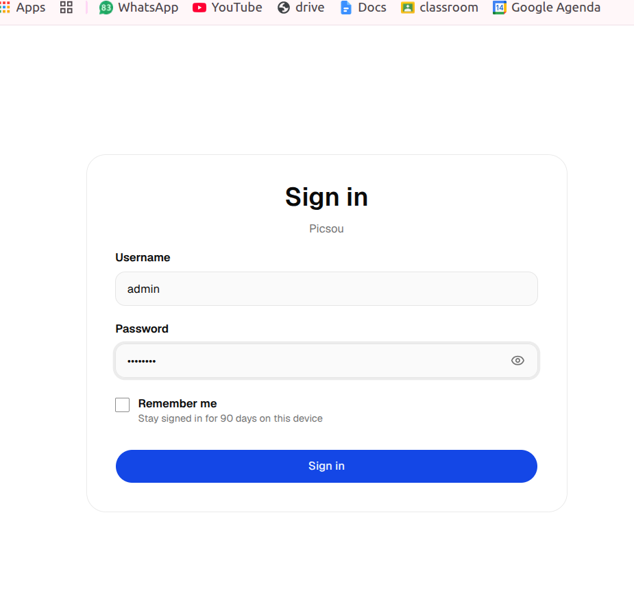

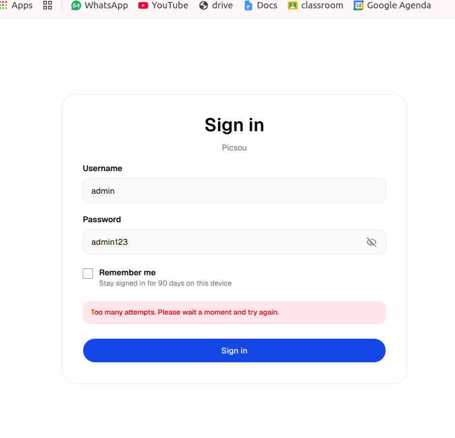

---

### 5.2 Execução 2 — Resultado: PASSED (Sucesso Pleno)
* **Data da Execução:** 10/11/2026
* **Executor:** `admin`
* **Status Geral:** ✅ **Passed**
* **Evidência Oficial:** [teste_2.pdf](teste_2-sucesso/teste_2.pdf) | [teste_2.html](teste_2-sucesso/teste_2.html)

#### Notas de Execução Registradas no TestLink:
* **Passo 1 (Passed):** *"login efetuado com sucesso e acesso a página inicial"*
* **Passo 2 (Passed):** *"foi aberta a aba goals com a opção de adicionar uma nova meta"*
* **Passo 3 (Passed):** *"abriu pop up de nova meta com campos nome da meta, valor e prazo pra ser preenchido"*
* **Passo 4 (Passed):** *"meta foi criada e aparece agora na aba de metas"*
* **Passo 5 (Passed):** *"abre as configurações de familia, podendo ajustar o compartilhamento de contas e metas"*
* **Passo 6 (Passed):** *"share goals foi alterado para share all"*
* **Passo 7 (Passed):** *"apos fazer logout volta a pagina de sign in"*
* **Passo 8 (Passed):** *"login feito e aberto pagina inicial"*
* **Passo 9 (Passed):** *"aparece shared net worth, shared accounts e shared goals, em shared goals aparece Reserva de Emergencia Familiar"*
* **Passo 10 (Passed):** *"no card dentro de shared goals consigo ver nome do usuario criador, nome da meta, valor total, valor atual e barra de progresso"*

> ### Evidências do segundo teste manual: 

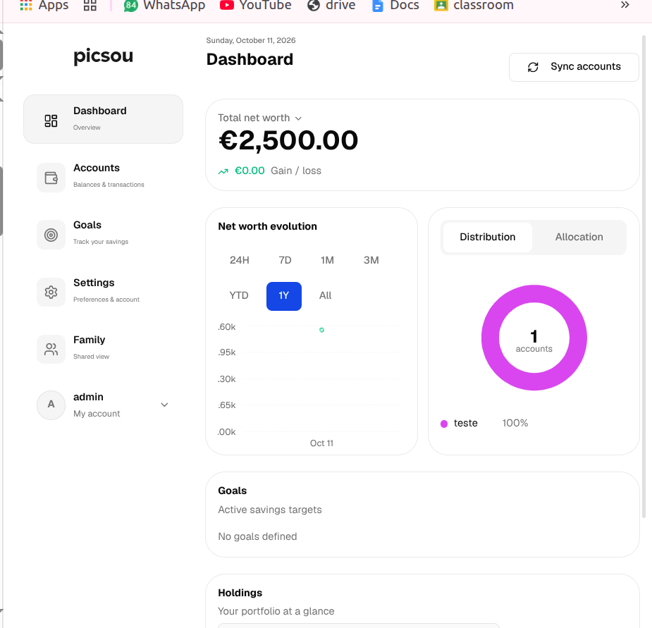

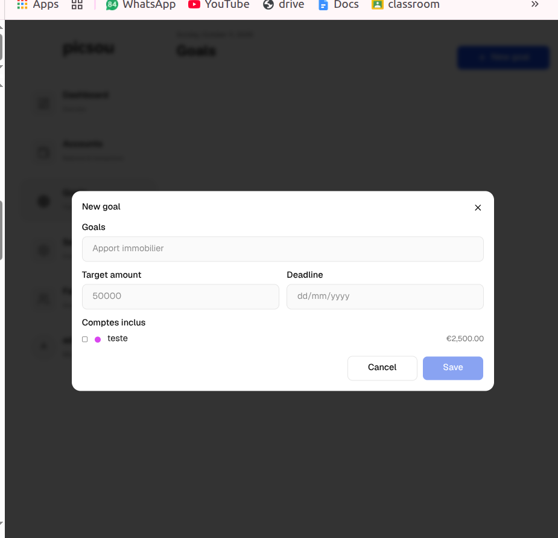

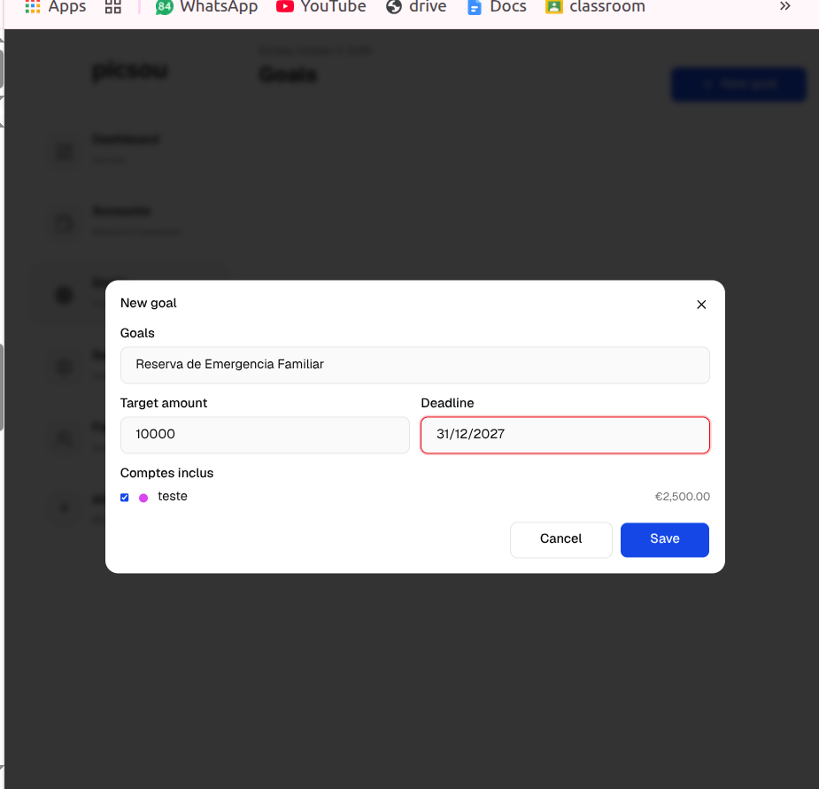

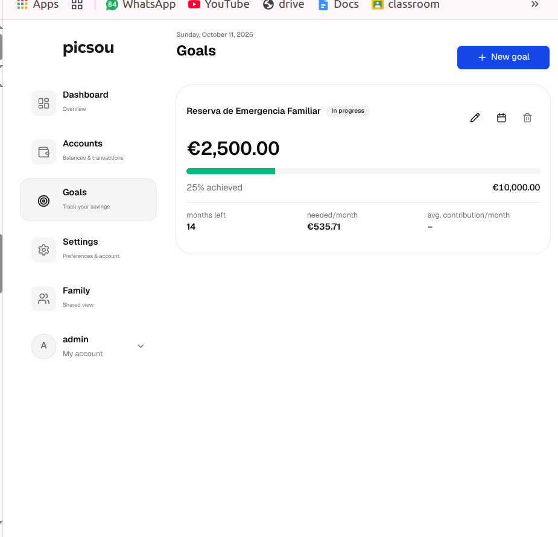

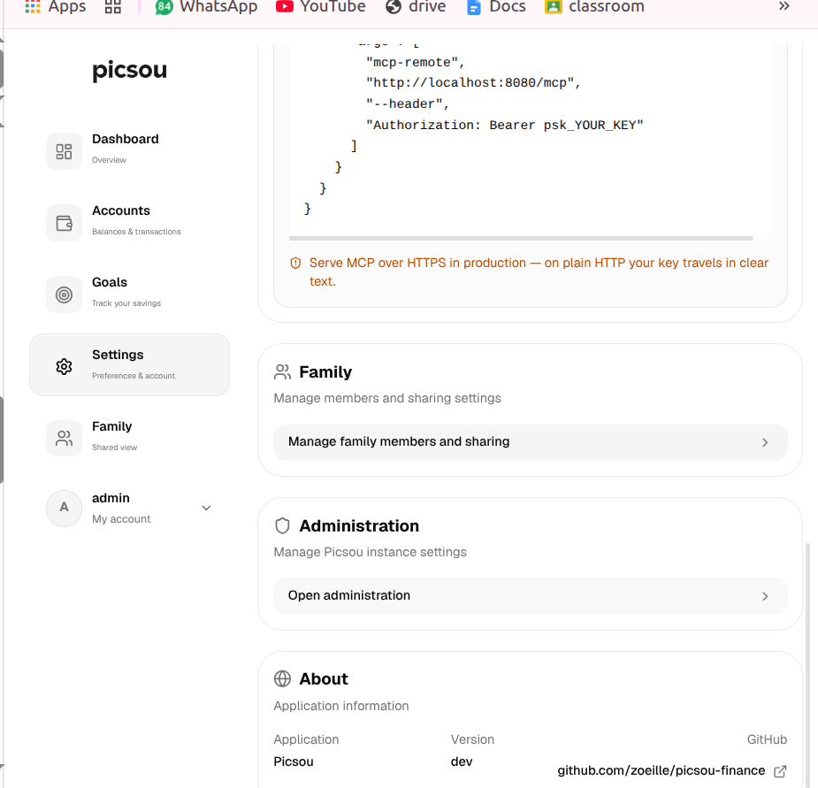

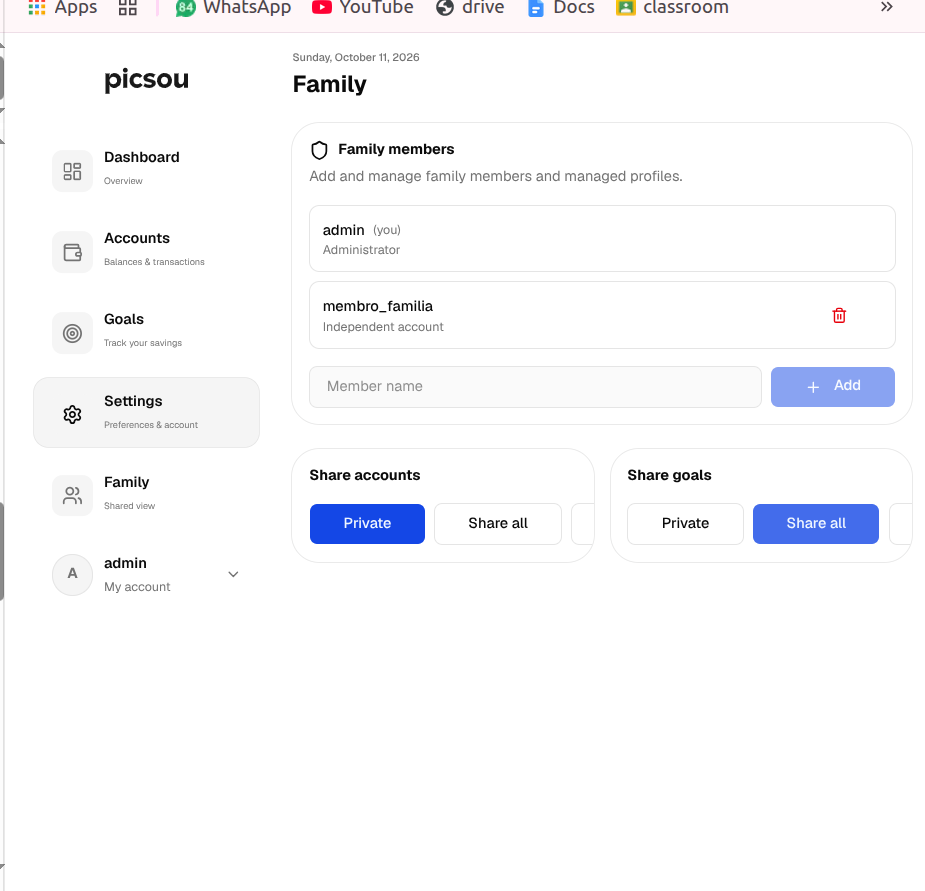

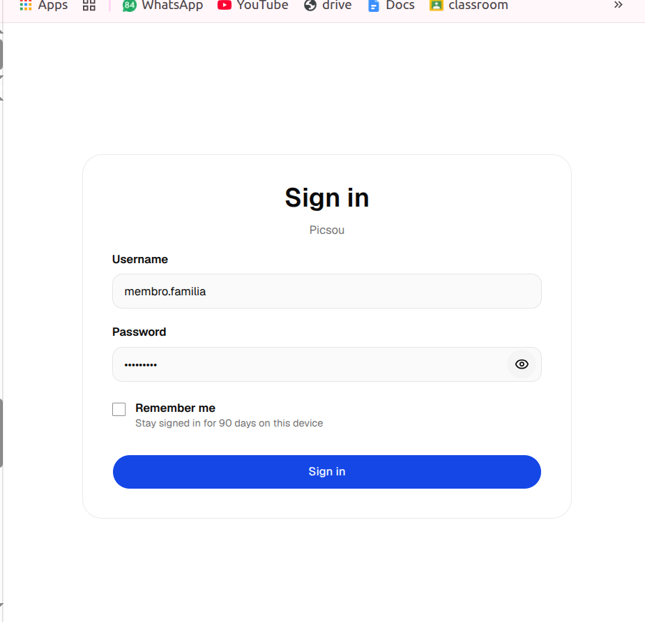

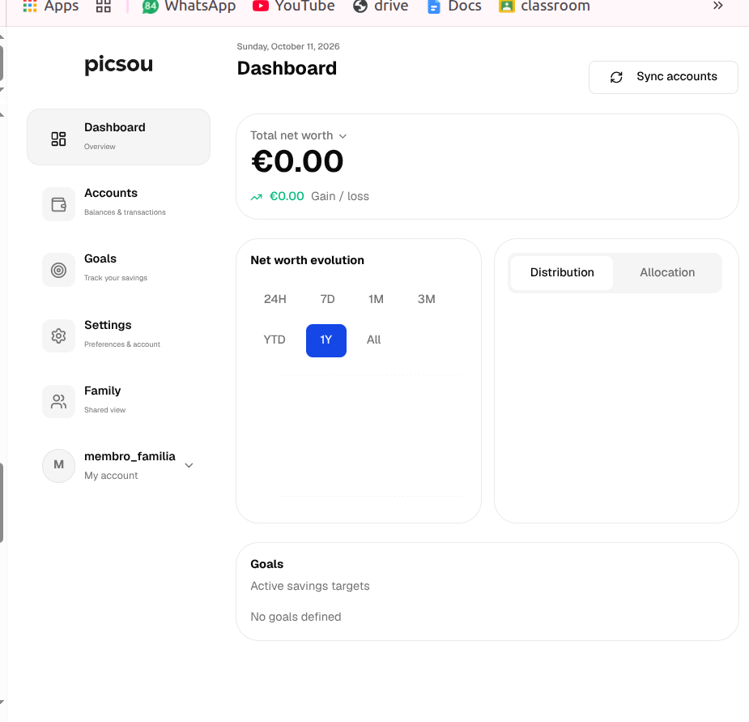

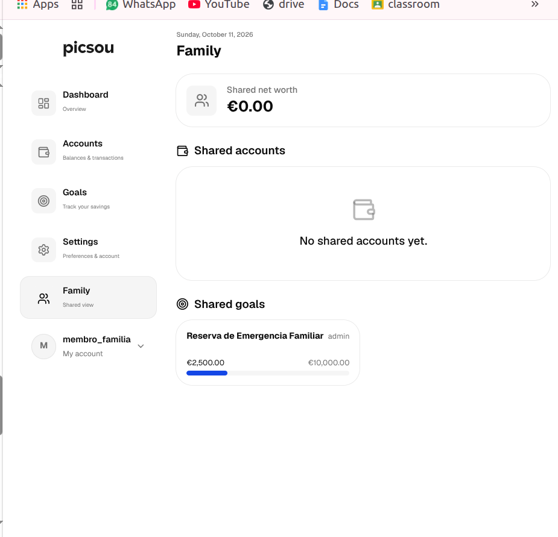